# AutoShield AI

### Resource-aware AutoML and causal network intrusion detection

AutoShield AI is an implemented machine-learning research framework for detecting malicious network traffic while measuring the cost and reliability of the detector. It brings together multi-objective model selection, controlled training pipelines, chronological adaptation experiments and bounded-memory behavioral inference.

**Start here:** [Implementation](src/autoshield/) · [Conducted experiments](conducted_experiments/README.md) · [Results and graph guide](results/README.md) · [Automated tests](https://github.com/SriharshithaSadhu/AutoShield-AI/actions/workflows/tests.yml)

## Contents

- [Problem domain](#problem-domain)
- [Project overview](#project-overview)
- [Implementation](#implementation)
- [Conducted experiments](#conducted-experiments)
- [Results and what they mean](#results-and-what-they-mean)
- [Graph-by-graph walkthrough](#graph-by-graph-walkthrough)
- [Installation and running](#installation-and-running)
- [Repository layout](#repository-layout)
- [Reproducibility and evaluation](#reproducibility-and-evaluation)
- [Research foundation](#research-foundation)

## Problem domain

### Why network intrusion detection is difficult

A network intrusion detection system examines traffic for activity such as scanning, denial-of-service attacks, credential attacks and exploitation attempts. A flow-based detector works with summaries of communication—protocol, packet and byte counts, duration, timing and directional statistics—rather than assuming access to every application payload.

The practical challenge is larger than recognizing attacks in a shuffled benchmark. A model must also avoid overwhelming analysts with false alarms, process traffic efficiently, and continue to work when services, devices or attack distributions change.

| Challenge | Why it matters | How this project investigates it |
|---|---|---|
| Missed attacks | A detector can appear accurate while missing rare or unfamiliar attacks. | Recall, per-family results and attack-coverage ablations. |
| False alarms | Even a small false-positive fraction can create a large alert workload at network scale. | FPR, false-alarm counts and worst-window measurements. |
| Deployment cost | A high-scoring model may be too expensive for the intended CPU or memory budget. | Inference timing, model size, working-memory measurements and feasibility checks. |
| Distribution change | Traffic from another period or environment can differ from the fitting data. | Chronological replay, cross-dataset transfer and multi-environment comparisons. |
| Delayed feedback | Correct labels may arrive after a model has already generated alerts or missed attacks. | Adaptation and verification experiments with explicit label availability. |
| Evaluation leakage | Repeated records or preprocessing fitted on evaluation data can inflate scores. | Grouped splits, fold-local transforms and separate development/protected roles. |

For scale, **0.1% FPR means approximately 1,000 false alarms for every million benign flows**. This is why the project reports false positives alongside recall and F1.

### Why AutoML and multi-objective optimization

Choosing a classifier, representation and hyperparameters creates competing objectives. More detection capability can cost more memory or latency; raising sensitivity can increase false alarms. AutoML makes candidate evaluation systematic, while multi-objective optimization retains useful tradeoffs instead of hiding them inside one score.

The implemented optimizer maintains a **Pareto archive**: candidates that are not dominated across the measured objectives. Feasibility-first selection gives preference to candidates satisfying the declared search constraints. The search evaluates F1, calibration, inference cost, model size and fit cost; the temporal studies additionally examine explicit recall/FPR operating requirements. These are related evaluation layers, not a claim that every search objective already guarantees future false-positive control.

## Project overview

The work began with reproducing the Yang–Shami MOO-AutoML IDS on CICIDS2017 and IoTID20. It then examined the engineering questions that arise when moving from benchmark classification to deployment-oriented evaluation:

1. Can candidate models be compared fairly under resource constraints?
2. Do results survive chronological and cross-environment evaluation?
3. When does adaptation recover detections, and when does it introduce harmful false alarms?
4. Does earlier traffic behavior add information missing from a single flow?
5. Are failures explained by model choice, data coverage, exporter conventions or insufficient observations?

The repository separates the installable implementation from the historical research studies. It includes **two baseline reproduction notebooks, nine organized experiment groups, 48 saved graphs, compact measured outputs and two frozen inference models**.

## Implementation

### 1. Training and evaluation

`preprocessing.py` separates the target and metadata, handles numeric features, and fits normalization and class balancing inside the training pipeline. `automl.py` provides grouped candidate evaluation so repeated feature vectors stay within the same fold. `evaluation.py` measures classifier quality, probability calibration, prediction timing and serialized model size.

### 2. Multi-objective search

`optimization.py` implements seeded MOPSO with bounded search dimensions, an external nondominated archive, feasibility-first comparison, evaluation caching and resumable checkpoints. Matched comparisons are used to test the optimizer rather than assume it must outperform simpler alternatives.

### 3. Causal traffic history

`observation.py` maintains host activity over 10- and 60-second horizons, including incoming/outgoing activity, capped distinct contacts, short-record patterns and TCP-failure proxies. The retained state is bounded to **4,096 hosts and 64 contacts per host**. Endpoint addresses serve as grouping keys, not predictor values.

Only observations with strictly earlier arrival timestamps affect the current record’s history. Records sharing a timestamp do not reveal information to one another. The failure indicators are flow-level proxies, not verified connection outcomes.

### 4. Inference

`runtime.py` validates completed-flow records, enforces the configured batch cap and performs native model inference. The runnable CSV scorer supports:

- **Flow-only:** 14 derived physical traffic features.
- **Hybrid:** those 14 features plus 24 causal behavioral features.

The default batch cap is 1,000 records. Inference needs no labels; output contains the record index, timestamp, score and alarm flag. An alarm is a model decision, not a verified incident.

### 5. Adaptation studies

The chronological experiment runner compares frozen, periodic and drift-triggered updates, with current-chunk labels released after prediction. The historical studies additionally examine label delay, rollback/recovery, review budgets and buffering costs. These comparisons are separate from the bundled fixed-model scorer.

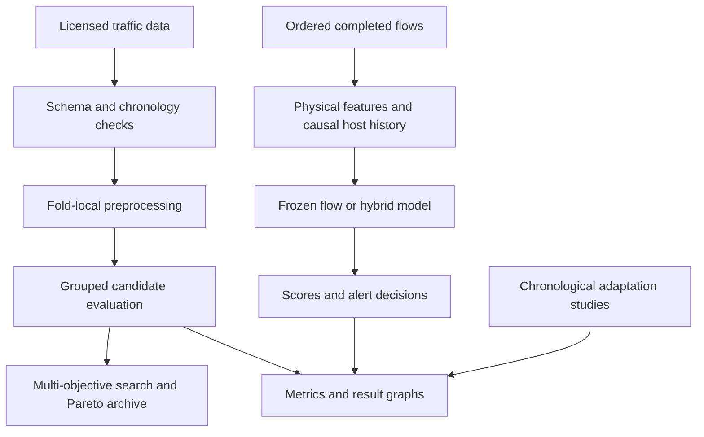

The diagram distinguishes the AutoML evaluation path from the frozen behavioral-model replay. The bundled models come from the recorded behavioral comparison; their results are not attributed to an untested joint AutoML/behavioral search.

### Technology stack

Python, NumPy, pandas, SciPy, scikit-learn, LightGBM, XGBoost, imbalanced-learn, DuckDB, joblib and Matplotlib. The installable package separates core dependencies from optional training and plotting dependencies. GitHub Actions runs the core tests on a clean Linux runner.

## Conducted experiments

| Study | What we did | What the evidence established |
|---|---|---|
| [Baseline reproduction](conducted_experiments/01_baseline_reproduction.md) | Compared conventional classifiers, balancing, selected features and tuned configurations on the base benchmarks. | Reproduced benchmark pipelines on CICIDS2017 and IoTID20; compared tree models, balancing, feature selection and tuning. These are benchmark-split reproduction results, not new cross-network performance. |
| [AutoML and resource constraints](conducted_experiments/02_automl_and_resource_constraints.md) | Implemented search constraints and repeated matched candidate/optimizer comparisons. | Implemented Pareto archives, feasibility-first search, repeated seeds and matched optimizer comparisons. Results do not establish consistent MOPSO superiority; measured compute and feasibility accompany quality metrics. |
| [Cross-dataset transfer](conducted_experiments/03_cross_dataset_transfer.md) | Checked feature compatibility and measured transfer by capture. | Audited feature compatibility and tested source-to-target transfer. Per-capture false alarms and recall reveal failures that pooled scores can conceal. |
| [Chronological adaptation](conducted_experiments/04_temporal_adaptation.md) | Compared frozen and update policies over ordered capture days/chunks. | Compared frozen, periodic, drift-triggered and threshold-update policies on ordered traffic. Adaptation can recover detection while introducing capture-level false-alarm risk. |
| [Delayed feedback and streaming safeguards](conducted_experiments/05_delayed_feedback_and_safeguards.md) | Measured update admission, recovery, switching, buffering and delayed feedback. | Evaluated label delays, approval, rollback, recovery and deadline batching. The work measures harmful updates, missed attacks, switching and delivery cost; it does not establish a universally safe update controller. |
| [Budgeted verification](conducted_experiments/06_budgeted_verification.md) | Compared disagreement review and decision-value allocation under budgets. | Compared randomized disagreement review and decision-value allocation under label/reviewer budgets. No reliable general advantage was established; this direction was not promoted as a successful new algorithm. |
| [Generalization and network context](conducted_experiments/07_generalization_and_context.md) | Tested fitting environments and causal service/direction context. | Compared single- and multi-environment fitting, robust/group-aware controls and legitimate service/direction context. Later-period performance remains below the joint recall/FPR requirement. |
| [Causal behavioral detection](conducted_experiments/08_behavioral_detection.md) | Compared flow, behavioral, hybrid and anomaly baselines with coverage/visibility controls. | Implemented bounded host histories and flow/behavioral/hybrid comparisons. Hybrid recall increases substantially on the full development replay, but false alarms exceed the target. Coverage and sensor-visibility controls are reported separately. |
| [Data integrity and observability](conducted_experiments/09_data_integrity_and_observability.md) | Audited timestamps, field conventions, labels, conflicts and temporal data suitability. | Verified timestamps, cache alignment, feature conventions and label consistency; screened temporal data sources. Empirical feature-collision bounds are scoped to the audited family and fixed records, not population guarantees. |

Each study links to its implementation and evidence. The [experiment catalog](conducted_experiments/README.md) is the navigation entry point; historical source is preserved under `conducted_experiments/source/` with workspace/input requirements identified separately.

## Results and what they mean

### Full chronological detection comparison

**Protocol:** frozen seed 42, 9,160,253 NF-ToN-IoT-v3 development flows; the prediction unit is the current completed flow. These are distinct from the original shuffled benchmark splits.

| Model | Attack recall | Precision | F1 | FPR | False alarms | Missed attacks |
|---|---:|---:|---:|---:|---:|---:|
| Flow-only | 36.51% | 97.72% | 0.5316 | 1.31% | 47,177 | 3,521,863 |
| Hybrid | 90.27% | 94.11% | 0.9215 | 8.68% | 313,590 | 539,874 |

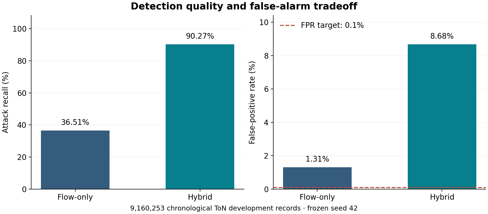

**What we achieved:** the implementation supports a full-density, reproducible comparison and demonstrates that behavioral history can recover substantially more attacks. **What it does not establish:** acceptable deployment reliability. The hybrid also produces many more false alarms; neither model reaches the study’s joint 50%-recall / 0.1%-FPR target. Reporting this tradeoff is more informative than selecting only the larger recall or F1.

### Resource measurements

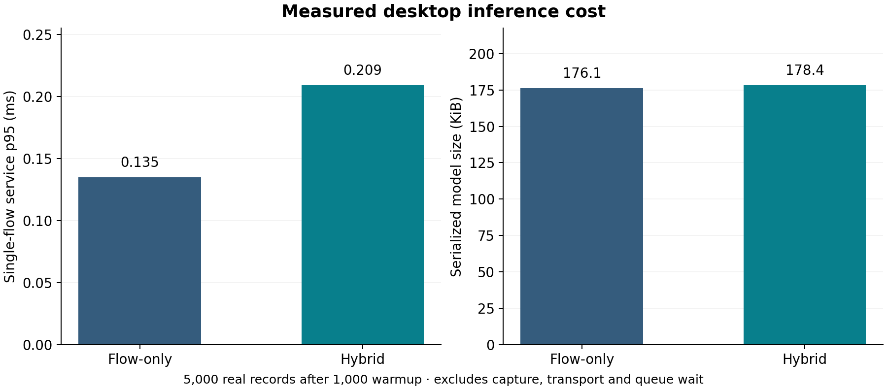

The measured single-flow service p95 is approximately **0.135 ms for flow-only** and **0.209 ms for hybrid**. The serialized models are approximately **176.1 KiB** and **178.4 KiB**, respectively. The isolated desktop benchmark uses 5,000 real records after 1,000 warmup records and includes feature computation, inference, thresholding and an in-memory consumer.

These service measurements exclude capture/export/network IO, queue waiting and startup. They do not establish on-device Raspberry Pi performance or a hard end-to-end alert deadline. Search-stage batch timing and this single-flow service benchmark are different measurements.

### Main findings

- **History adds information:** it reduces exact fitting-vector conflicts and recovers attacks missed by the flow baseline, but local separation does not guarantee later-period generalization.
- **Coverage matters:** withholding a fitting family changes what models detect; nearby-period robustness can disappear in the later stress period.
- **False alarms are a first-class outcome:** supported-window analysis reveals bursts that pooled metrics can hide.
- **Recency is not diversity:** a newer benign fitting window may still omit important service behavior.
- **Optimization is evidence-driven:** matched comparisons do not establish consistent MOPSO superiority.
- **Data validity is separate from model accuracy:** timestamp availability, exporter definitions and label provenance must be checked before interpreting a replay.

The [machine-readable detector results](results/metrics.json), [resource measurements](results/resource_benchmark.json) and [measurement catalog](results/measurement_catalog.json) accompany the graphs.

## Graph-by-graph walkthrough

**Every saved graph is explained below. Expand a study to see what was run, how to read its plots and what the result supports.** Full-size images and source references are also available in the [separate results guide](results/README.md).

### How to read the graphs

- **Confusion matrices:** diagonal cells are correct predictions; off-diagonal cells expose class-level mistakes. A large benign class can conceal weaker rare-class recall.
- **Feature-importance plots:** describe a recorded selection/ranking, not causal relevance or guaranteed transferability.
- **Recall/FPR tradeoffs:** more detected attacks must be assessed alongside false alarms and the declared operating budget.
- **Chronological plots:** show when errors occur. Quiet gaps or unsupported windows are not evidence of zero errors.
- **Data-composition plots:** describe dataset availability and campaign support, not classifier accuracy.
- **Label-assisted bounds:** are diagnostic empirical optima on the audited records, not deployable thresholds or future guarantees.

### Overview graphs

1. **Detection tradeoff:** we replayed the full development tail with frozen flow/hybrid models. The graph shows the large recall increase together with the increase in FPR; it explains why the higher-recall model does not yet satisfy the operating requirement.
2. **Resource cost:** we measured model size and single-flow service on the desktop. The graph documents compact model artifacts and the additional service cost of the hybrid pipeline under that workload.

<details>
<summary><strong>Baseline reproduction — 23 saved graphs</strong></summary>

#### 1. CICIDS2017 — Decision Tree baseline


**What we did:** Fitted the named conventional classifier as a baseline and plotted its confusion matrix on the notebook’s recorded evaluation split.

**What the graph establishes:** Saved reproduction confusion matrix: diagonal cells are correct classifications and off-diagonal cells expose class errors. This demonstrates the named benchmark stage, not cross-network generalization or superiority over other stages.

**Recorded metric:** The saved reference-notebook output reports accuracy **99.42%**, reported average F1 **0.9941**. These values belong to that notebook split and are not the later chronological replay results.

#### 2. CICIDS2017 — Random Forest baseline


**What we did:** Fitted the named conventional classifier as a baseline and plotted its confusion matrix on the notebook’s recorded evaluation split.

**What the graph establishes:** Saved reproduction confusion matrix: diagonal cells are correct classifications and off-diagonal cells expose class errors. This demonstrates the named benchmark stage, not cross-network generalization or superiority over other stages.

**Recorded metric:** The saved reference-notebook output reports accuracy **98.92%**, reported average F1 **0.9890**. These values belong to that notebook split and are not the later chronological replay results.

#### 3. CICIDS2017 — Extra Trees baseline

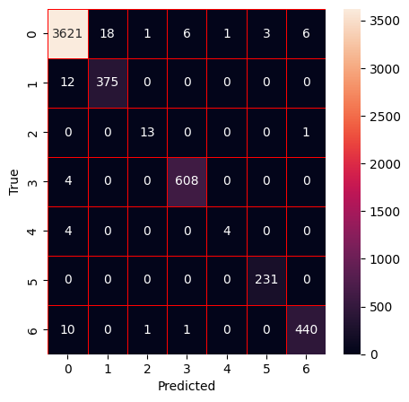

**What we did:** Fitted the named conventional classifier as a baseline and plotted its confusion matrix on the notebook’s recorded evaluation split.

**What the graph establishes:** Saved reproduction confusion matrix: diagonal cells are correct classifications and off-diagonal cells expose class errors. This demonstrates the named benchmark stage, not cross-network generalization or superiority over other stages.

**Recorded metric:** The saved reference-notebook output reports accuracy **98.73%**, reported average F1 **0.9872**. These values belong to that notebook split and are not the later chronological replay results.

#### 4. CICIDS2017 — LightGBM baseline


**What we did:** Fitted the named conventional classifier as a baseline and plotted its confusion matrix on the notebook’s recorded evaluation split.

**What the graph establishes:** Saved reproduction confusion matrix: diagonal cells are correct classifications and off-diagonal cells expose class errors. This demonstrates the named benchmark stage, not cross-network generalization or superiority over other stages.

**Recorded metric:** The saved reference-notebook output reports accuracy **99.66%**, reported average F1 **0.9965**. These values belong to that notebook split and are not the later chronological replay results.

#### 5. CICIDS2017 — LightGBM after balancing


**What we did:** Applied the notebook’s hybrid class-balancing stage, refitted the named classifier and inspected its class-level predictions.

**What the graph establishes:** Saved reproduction confusion matrix: diagonal cells are correct classifications and off-diagonal cells expose class errors. This demonstrates the named benchmark stage, not cross-network generalization or superiority over other stages.

**Recorded metric:** The saved reference-notebook output reports accuracy **99.76%**, reported average F1 **0.9975**. These values belong to that notebook split and are not the later chronological replay results.

#### 6. CICIDS2017 — XGBoost after balancing


**What we did:** Applied the notebook’s hybrid class-balancing stage, refitted the named classifier and inspected its class-level predictions.

**What the graph establishes:** Saved reproduction confusion matrix: diagonal cells are correct classifications and off-diagonal cells expose class errors. This demonstrates the named benchmark stage, not cross-network generalization or superiority over other stages.

**Recorded metric:** The saved reference-notebook output reports accuracy **99.74%**, reported average F1 **0.9974**. These values belong to that notebook split and are not the later chronological replay results.

#### 7. CICIDS2017 — Selected feature importance

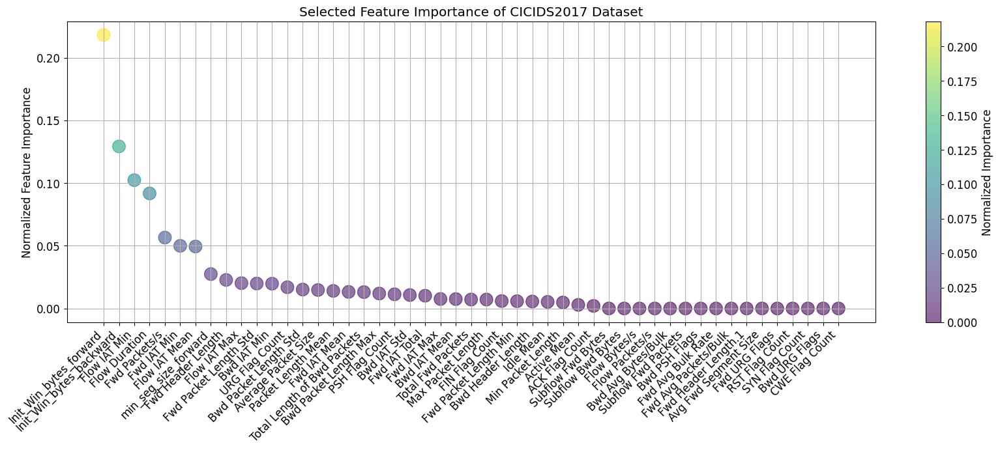

**What we did:** Ran the feature-selection stage and plotted the retained features and their normalized importance.

**What the graph establishes:** Saved reproduction output: ranks selected features; importance is not causal evidence.

#### 8. CICIDS2017 — LightGBM after feature selection

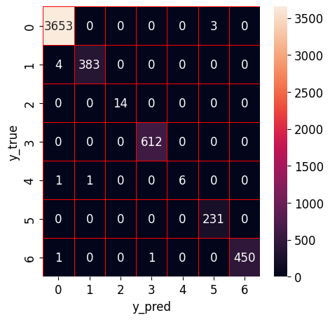

**What we did:** Refitted the named classifier on the selected feature subset to examine the effect of the feature-selection stage.

**What the graph establishes:** Saved reproduction confusion matrix: diagonal cells are correct classifications and off-diagonal cells expose class errors. This demonstrates the named benchmark stage, not cross-network generalization or superiority over other stages.

**Recorded metric:** The saved reference-notebook output reports accuracy **99.79%**, reported average F1 **0.9979**. These values belong to that notebook split and are not the later chronological replay results.

#### 9. CICIDS2017 — XGBoost after feature selection


**What we did:** Refitted the named classifier on the selected feature subset to examine the effect of the feature-selection stage.

**What the graph establishes:** Saved reproduction confusion matrix: diagonal cells are correct classifications and off-diagonal cells expose class errors. This demonstrates the named benchmark stage, not cross-network generalization or superiority over other stages.

**Recorded metric:** The saved reference-notebook output reports accuracy **99.76%**, reported average F1 **0.9975**. These values belong to that notebook split and are not the later chronological replay results.

#### 10. CICIDS2017 — Tuned LightGBM


**What we did:** Ran the notebook’s configuration-optimization stage and plotted the tuned classifier’s class-level predictions.

**What the graph establishes:** Saved reproduction confusion matrix: diagonal cells are correct classifications and off-diagonal cells expose class errors. This demonstrates the named benchmark stage, not cross-network generalization or superiority over other stages.

**Recorded metric:** The saved reference-notebook output reports accuracy **99.72%**, reported average F1 **0.9972**. These values belong to that notebook split and are not the later chronological replay results.

#### 11. CICIDS2017 — Tuned XGBoost


**What we did:** Ran the notebook’s configuration-optimization stage and plotted the tuned classifier’s class-level predictions.

**What the graph establishes:** Saved reproduction confusion matrix: diagonal cells are correct classifications and off-diagonal cells expose class errors. This demonstrates the named benchmark stage, not cross-network generalization or superiority over other stages.

**Recorded metric:** The saved reference-notebook output reports accuracy **99.76%**, reported average F1 **0.9975**. These values belong to that notebook split and are not the later chronological replay results.

#### 12. IoTID20 — Decision Tree baseline


**What we did:** Fitted the named conventional classifier as a baseline and plotted its confusion matrix on the notebook’s recorded evaluation split.

**What the graph establishes:** Saved reproduction confusion matrix: diagonal cells are correct classifications and off-diagonal cells expose class errors. This demonstrates the named benchmark stage, not cross-network generalization or superiority over other stages.

**Recorded metric:** The saved reference-notebook output reports accuracy **99.97%**, reported average F1 **0.9997**. These values belong to that notebook split and are not the later chronological replay results.

#### 13. IoTID20 — Random Forest baseline


**What we did:** Fitted the named conventional classifier as a baseline and plotted its confusion matrix on the notebook’s recorded evaluation split.

**What the graph establishes:** Saved reproduction confusion matrix: diagonal cells are correct classifications and off-diagonal cells expose class errors. This demonstrates the named benchmark stage, not cross-network generalization or superiority over other stages.

**Recorded metric:** The saved reference-notebook output reports accuracy **99.22%**, reported average F1 **0.9922**. These values belong to that notebook split and are not the later chronological replay results.

#### 14. IoTID20 — Extra Trees baseline


**What we did:** Fitted the named conventional classifier as a baseline and plotted its confusion matrix on the notebook’s recorded evaluation split.

**What the graph establishes:** Saved reproduction confusion matrix: diagonal cells are correct classifications and off-diagonal cells expose class errors. This demonstrates the named benchmark stage, not cross-network generalization or superiority over other stages.

**Recorded metric:** The saved reference-notebook output reports accuracy **98.52%**, reported average F1 **0.9851**. These values belong to that notebook split and are not the later chronological replay results.

#### 15. IoTID20 — XGBoost baseline


**What we did:** Fitted the named conventional classifier as a baseline and plotted its confusion matrix on the notebook’s recorded evaluation split.

**What the graph establishes:** Saved reproduction confusion matrix: diagonal cells are correct classifications and off-diagonal cells expose class errors. This demonstrates the named benchmark stage, not cross-network generalization or superiority over other stages.

**Recorded metric:** The saved reference-notebook output reports accuracy **99.99%**, reported average F1 **0.9999**. These values belong to that notebook split and are not the later chronological replay results.

#### 16. IoTID20 — LightGBM baseline

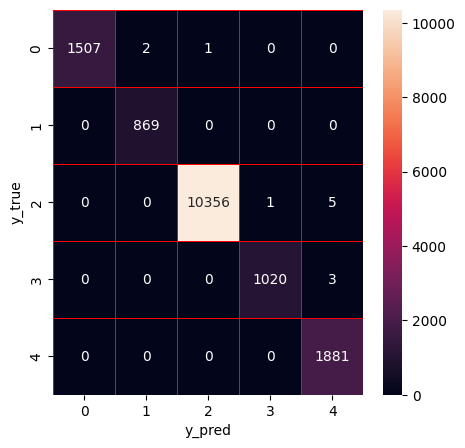

**What we did:** Fitted the named conventional classifier as a baseline and plotted its confusion matrix on the notebook’s recorded evaluation split.

**What the graph establishes:** Saved reproduction confusion matrix: diagonal cells are correct classifications and off-diagonal cells expose class errors. This demonstrates the named benchmark stage, not cross-network generalization or superiority over other stages.

**Recorded metric:** The saved reference-notebook output reports accuracy **99.92%**, reported average F1 **0.9992**. These values belong to that notebook split and are not the later chronological replay results.

#### 17. IoTID20 — LightGBM after balancing


**What we did:** Applied the notebook’s hybrid class-balancing stage, refitted the named classifier and inspected its class-level predictions.

**What the graph establishes:** Saved reproduction confusion matrix: diagonal cells are correct classifications and off-diagonal cells expose class errors. This demonstrates the named benchmark stage, not cross-network generalization or superiority over other stages.

**Recorded metric:** The saved reference-notebook output reports accuracy **99.96%**, reported average F1 **0.9996**. These values belong to that notebook split and are not the later chronological replay results.

#### 18. IoTID20 — XGBoost after balancing

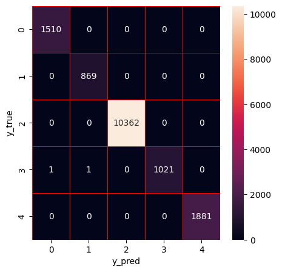

**What we did:** Applied the notebook’s hybrid class-balancing stage, refitted the named classifier and inspected its class-level predictions.

**What the graph establishes:** Saved reproduction confusion matrix: diagonal cells are correct classifications and off-diagonal cells expose class errors. This demonstrates the named benchmark stage, not cross-network generalization or superiority over other stages.

**Recorded metric:** The saved reference-notebook output reports accuracy **99.99%**, reported average F1 **0.9999**. These values belong to that notebook split and are not the later chronological replay results.

#### 19. IoTID20 — Selected feature importance

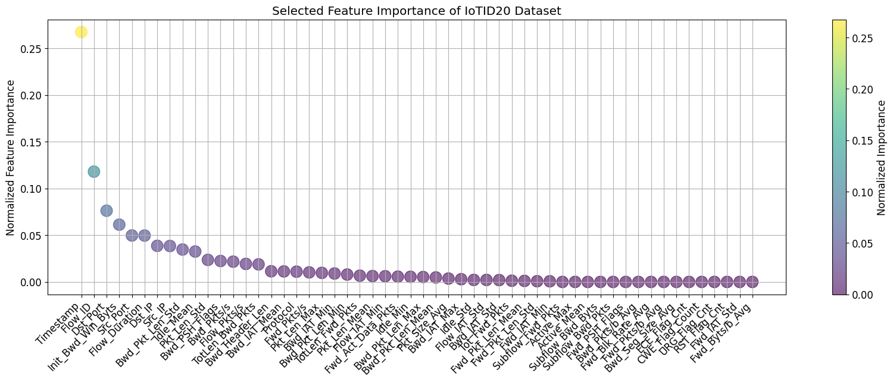

**What we did:** Ran the feature-selection stage and plotted the retained features and their normalized importance.

**What the graph establishes:** Saved reproduction output: ranks selected features; importance is not causal evidence.

#### 20. IoTID20 — LightGBM after feature selection

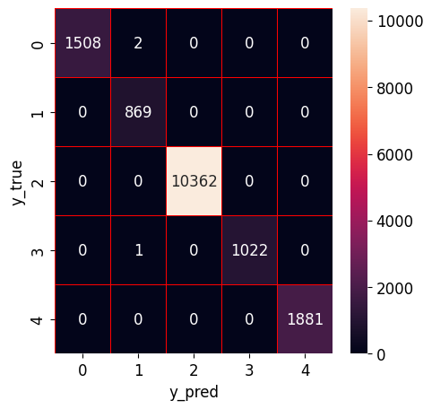

**What we did:** Refitted the named classifier on the selected feature subset to examine the effect of the feature-selection stage.

**What the graph establishes:** Saved reproduction confusion matrix: diagonal cells are correct classifications and off-diagonal cells expose class errors. This demonstrates the named benchmark stage, not cross-network generalization or superiority over other stages.

**Recorded metric:** The saved reference-notebook output reports accuracy **99.98%**, reported average F1 **0.9998**. These values belong to that notebook split and are not the later chronological replay results.

#### 21. IoTID20 — XGBoost after feature selection

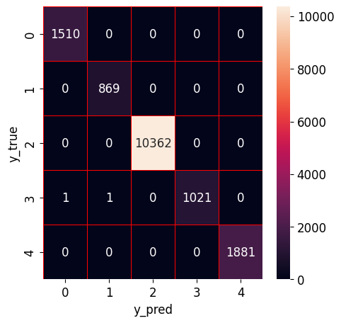

**What we did:** Refitted the named classifier on the selected feature subset to examine the effect of the feature-selection stage.

**What the graph establishes:** Saved reproduction confusion matrix: diagonal cells are correct classifications and off-diagonal cells expose class errors. This demonstrates the named benchmark stage, not cross-network generalization or superiority over other stages.

**Recorded metric:** The saved reference-notebook output reports accuracy **99.99%**, reported average F1 **0.9999**. These values belong to that notebook split and are not the later chronological replay results.

#### 22. IoTID20 — Tuned LightGBM


**What we did:** Ran the notebook’s configuration-optimization stage and plotted the tuned classifier’s class-level predictions.

**What the graph establishes:** Saved reproduction confusion matrix: diagonal cells are correct classifications and off-diagonal cells expose class errors. This demonstrates the named benchmark stage, not cross-network generalization or superiority over other stages.

**Recorded metric:** The saved reference-notebook output reports accuracy **99.99%**, reported average F1 **0.9999**. These values belong to that notebook split and are not the later chronological replay results.

#### 23. IoTID20 — Tuned XGBoost


**What we did:** Ran the notebook’s configuration-optimization stage and plotted the tuned classifier’s class-level predictions.

**What the graph establishes:** Saved reproduction confusion matrix: diagonal cells are correct classifications and off-diagonal cells expose class errors. This demonstrates the named benchmark stage, not cross-network generalization or superiority over other stages.

**Recorded metric:** The saved reference-notebook output reports accuracy **99.99%**, reported average F1 **0.9999**. These values belong to that notebook split and are not the later chronological replay results.

[Experiment implementation](conducted_experiments/01_baseline_reproduction.md) · [Full result page](results/01_baseline_reproduction.md)

</details>

<details>
<summary><strong>AutoML and resource constraints — 1 saved graphs</strong></summary>

#### 1. Selection stability under budget constraints

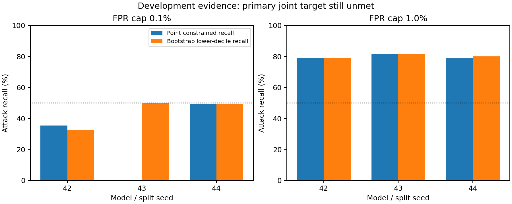

**What we did:** Repeated resource-constrained candidate selection and calibration-partition checks to test how stable the selected operating points were.

**What the graph establishes:** Checks the stability of candidate selection and calibrated operating points. The primary combined recall/FPR requirement was not reliably met.

[Experiment implementation](conducted_experiments/02_automl_and_resource_constraints.md) · [Full result page](results/02_automl_and_resource_constraints.md)

</details>

<details>
<summary><strong>Cross-dataset transfer — 2 saved graphs</strong></summary>

#### 1. Transfer threshold-gate feasibility

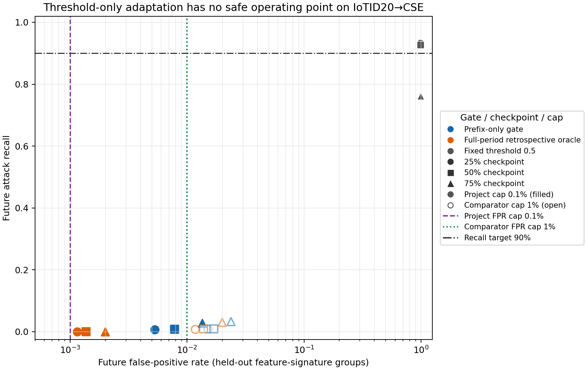

**What we did:** Evaluated threshold policies against recall and false-positive requirements rather than selecting on F1 alone.

**What the graph establishes:** Tests whether transferred scores support the declared recall and false-positive budgets. Failed operating points remain visible; threshold control alone is insufficient.

#### 2. Transfer risk by capture

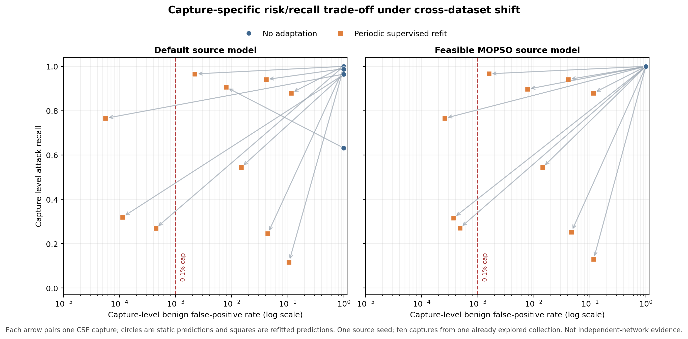

**What we did:** Applied source-trained models to target captures and examined capture-specific detection and false-positive outcomes.

**What the graph establishes:** Separates capture-specific recall and false alarms rather than treating pooled performance as deployment safety.

[Experiment implementation](conducted_experiments/03_cross_dataset_transfer.md) · [Full result page](results/03_cross_dataset_transfer.md)

</details>

<details>
<summary><strong>Chronological adaptation — 5 saved graphs</strong></summary>

#### 1. CSE adaptation across capture days

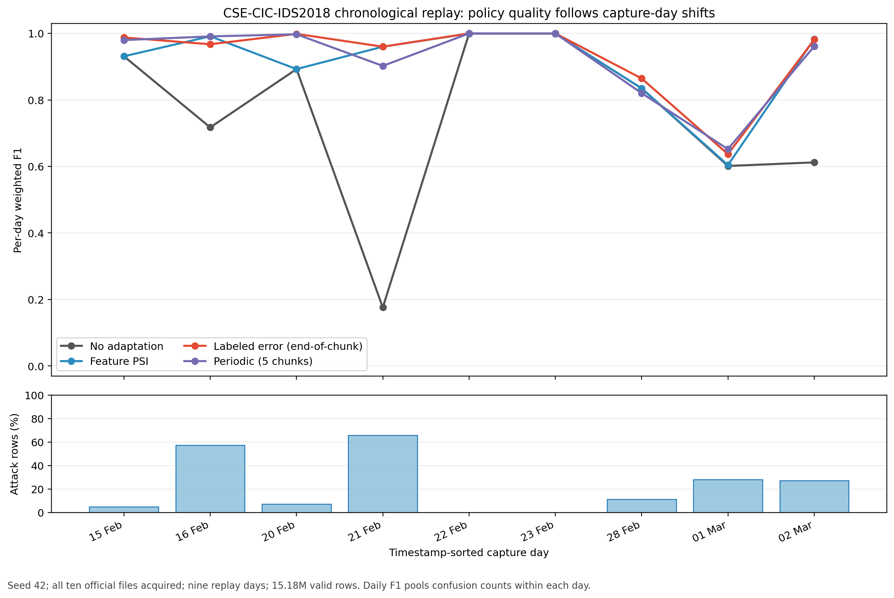

**What we did:** Scored chronologically ordered traffic with frozen and update-policy baselines and compared behavior across days or chunks.

**What the graph establishes:** Compares daily F1 across frozen and update policies. Performance varies by capture; a pooled adaptation gain does not establish uniform safety.

#### 2. Threshold recalibration, seed 42

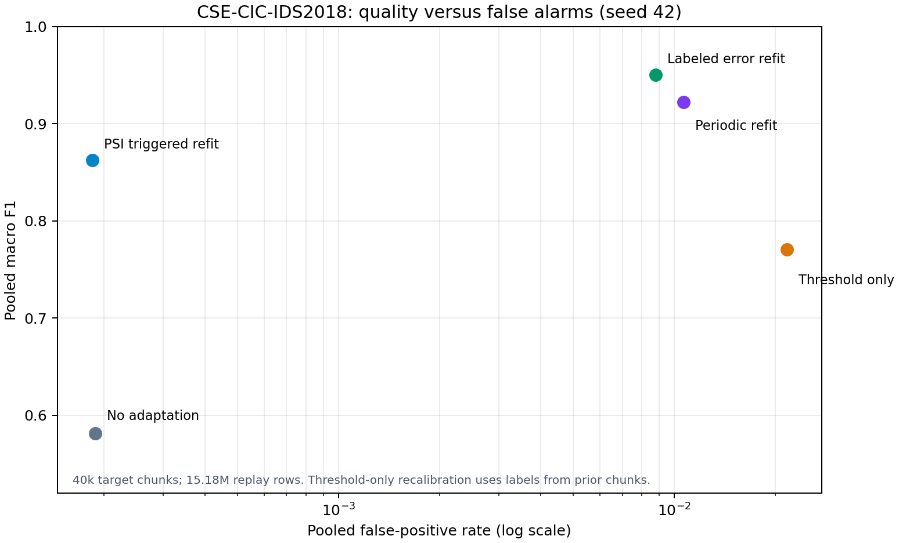

**What we did:** Evaluated threshold policies against recall and false-positive requirements rather than selecting on F1 alone.

**What the graph establishes:** Shows the recall/false-alarm tradeoff from threshold-only changes. Recalibration is distinct from improving the score ranking.

#### 3. Threshold recalibration across two seeds

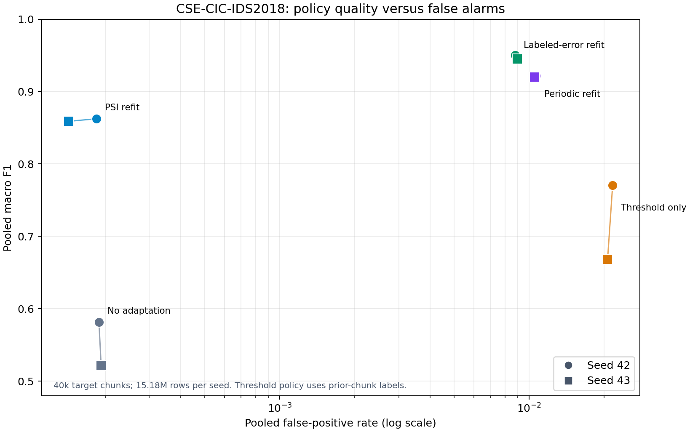

**What we did:** Evaluated threshold policies against recall and false-positive requirements rather than selecting on F1 alone.

**What the graph establishes:** Checks whether the same-stream tradeoff changes with model seed. Repeated seeds are not independent-network validation.

#### 4. Smart-factory chronological replay

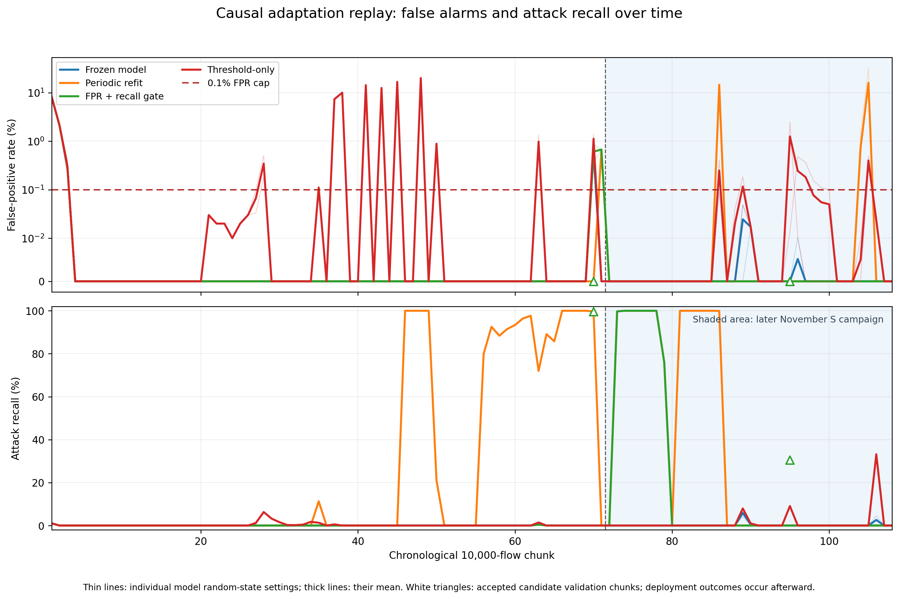

**What we did:** Scored chronologically ordered traffic with frozen and update-policy baselines and compared behavior across days or chunks.

**What the graph establishes:** Compares policies over successive chunks. A low-FPR policy can still lose useful attack detections; family and chunk behavior must accompany pooled metrics.

#### 5. APEX frozen-model replay

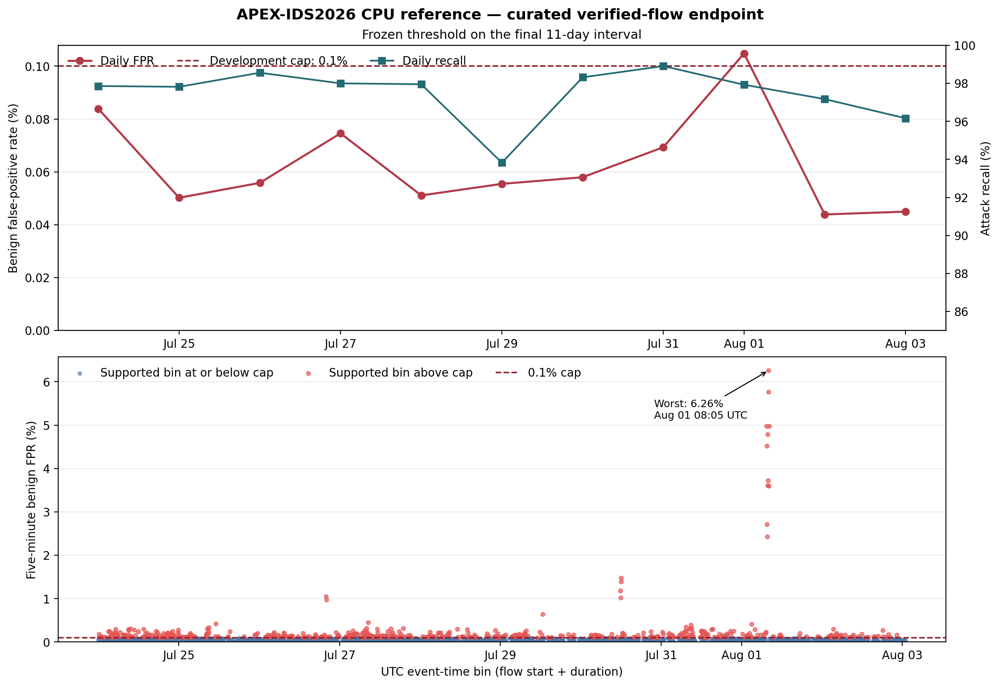

**What we did:** Kept the model fixed and measured its detection behavior over successive temporal periods without attributing the outcome to adaptation.

**What the graph establishes:** Measures fixed-model behavior across temporal segments. This is additional development evidence, not a successful adaptation or independent-confirmation claim.

[Experiment implementation](conducted_experiments/04_temporal_adaptation.md) · [Full result page](results/04_temporal_adaptation.md)

</details>

<details>
<summary><strong>Delayed feedback and streaming safeguards — 1 saved graphs</strong></summary>

#### 1. Validate-before-commit comparison

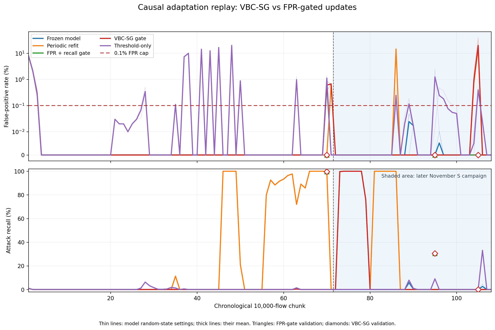

**What we did:** Compared update-admission policies using the same campaign stream and examined false alarms, recall and policy variation.

**What the graph establishes:** Evaluates source-method admission and an FPR-oriented gate on a shared campaign. This is a same-stream development comparison; label-evidence budgets are not fully matched.

[Experiment implementation](conducted_experiments/05_delayed_feedback_and_safeguards.md) · [Full result page](results/05_delayed_feedback_and_safeguards.md)

</details>

<details>
<summary><strong>Budgeted verification — 0 saved graphs</strong></summary>

This study’s evidence is tabulated rather than plotted as a standalone saved PNG. Open its [experiment description](conducted_experiments/06_budgeted_verification.md) and [recorded measurements](results/06_budgeted_verification.md) for the implemented comparison and outcomes.

[Experiment implementation](conducted_experiments/06_budgeted_verification.md) · [Full result page](results/06_budgeted_verification.md)

</details>

<details>
<summary><strong>Generalization and network context — 5 saved graphs</strong></summary>

#### 1. Context representation ablation

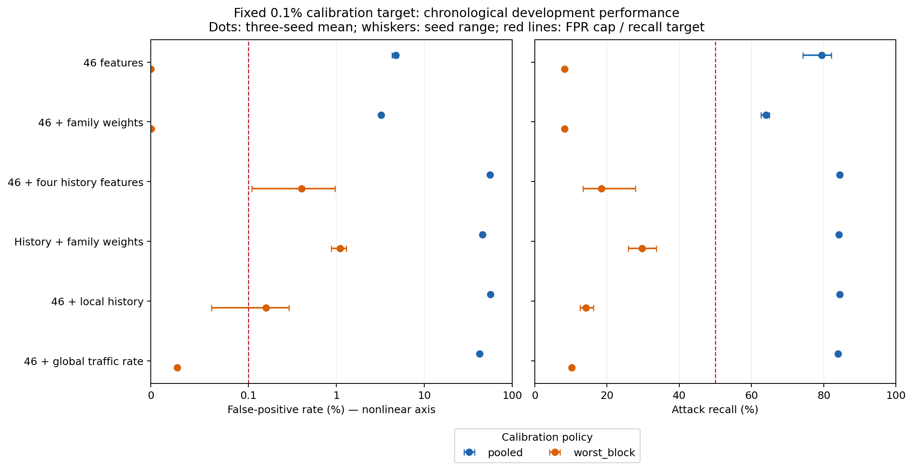

**What we did:** Compared representations or fitting environments under matched conditions, then checked performance on later traffic.

**What the graph establishes:** Separates representation effects across chronological windows and selection rules. Context additions do not automatically restore feasibility.

#### 2. Matched multi-environment fitting

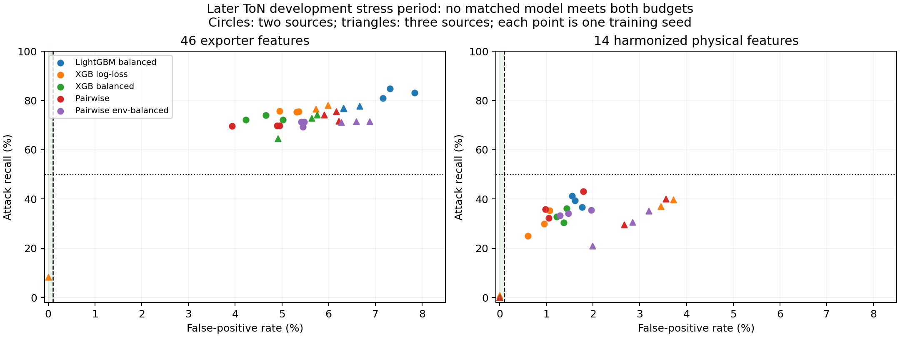

**What we did:** Compared representations or fitting environments under matched conditions, then checked performance on later traffic.

**What the graph establishes:** Compares training exposure under matched conditions. Nearby-period gains do not guarantee later-period low-FPR generalization.

#### 3. Low-FPR ranking limits

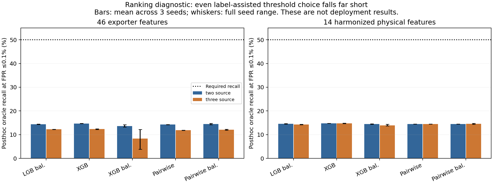

**What we did:** Inspected fitted-score ordering at a fixed false-positive budget to distinguish a weak ranking from a threshold-selection problem.

**What the graph establishes:** Uses retrospective labels to diagnose recall achievable from fitted scores at fixed FPR. These thresholds are not deployable or used for protected tuning.

#### 4. Service, direction and protocol context

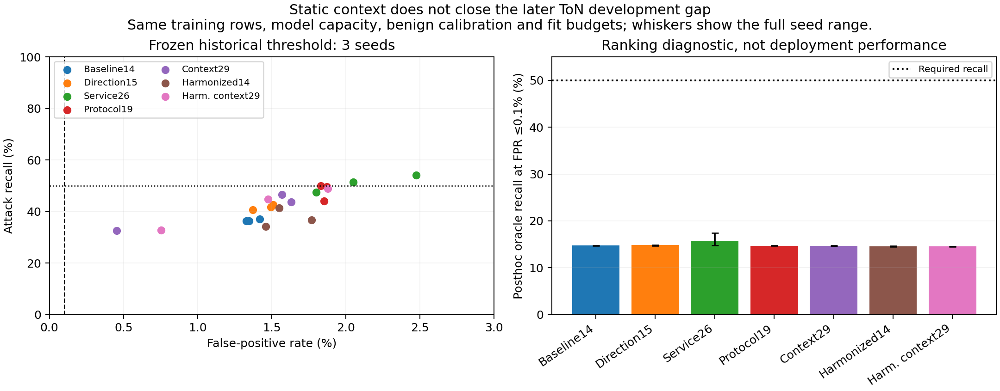

**What we did:** Compared representations or fitting environments under matched conditions, then checked performance on later traffic.

**What the graph establishes:** Compares causal contextual representations with the flow baseline. None of these contextual variants restored the required later-period joint operating point.

#### 5. Full-density contextual tail risk

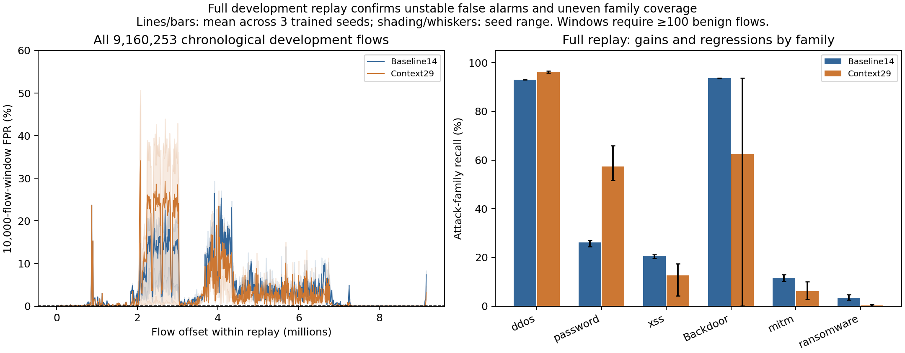

**What we did:** Broke the chronological replay into supported windows and inspected local errors alongside the pooled score.

**What the graph establishes:** Shows how errors vary over real chronological windows. Worst-window false alarms can remain severe even when pooled metrics look less extreme.

[Experiment implementation](conducted_experiments/07_generalization_and_context.md) · [Full result page](results/07_generalization_and_context.md)

</details>

<details>
<summary><strong>Causal behavioral detection — 3 saved graphs</strong></summary>

#### 1. Full behavioral detector comparison

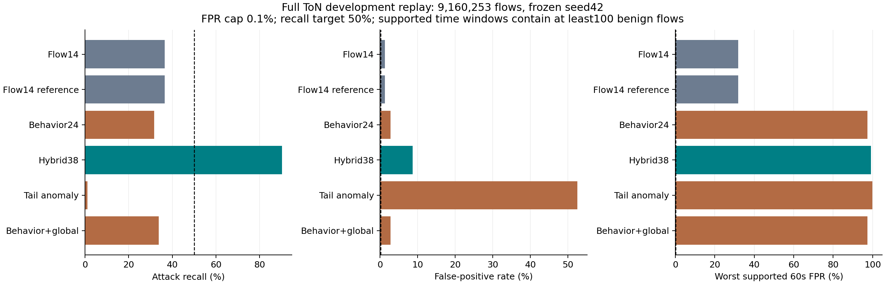

**What we did:** Replayed the complete development tail through frozen flow, behavioral, anomaly and hybrid pipelines using actual per-batch model calls.

**What the graph establishes:** Six frozen pipelines score 9,160,253 development flows. The hybrid raises recall to 90.27% but also raises FPR to 8.68%; this fails the deployment operating point.

#### 2. Behavioral false alarms over time

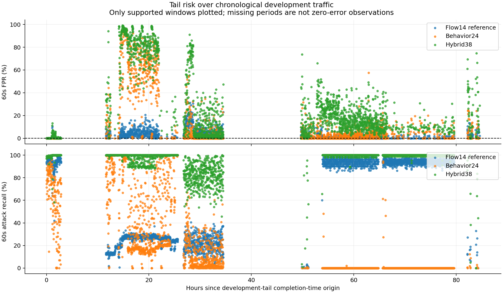

**What we did:** Broke the chronological replay into supported windows and inspected local errors alongside the pooled score.

**What the graph establishes:** Separates supported-minute FPR and recall across the replay. Behavioral/hybrid detectors can have extreme localized false alarms despite high pooled recall.

#### 3. Fitting-family coverage ablation

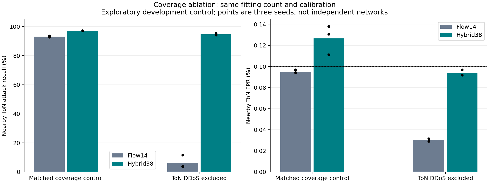

**What we did:** Withheld a named attack family from fitting and compared flow and hybrid models against a matched training-count control.

**What the graph establishes:** With ToN DDoS excluded from fitting, the hybrid retains strong nearby recall while the flow baseline drops. This local finding fails to generalize to the later stress period and is not proof of zero-day detection.

[Experiment implementation](conducted_experiments/08_behavioral_detection.md) · [Full result page](results/08_behavioral_detection.md)

</details>

<details>
<summary><strong>Data integrity and observability — 6 saved graphs</strong></summary>

#### 1. ToN hourly campaign composition

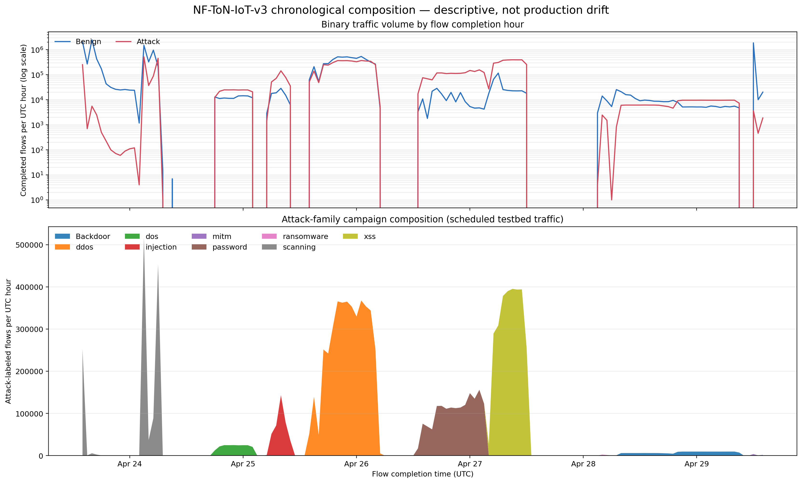

**What we did:** Audited time ordering, class support and feature availability before treating the dataset as a chronological evaluation stream.

**What the graph establishes:** Establishes chronological attack-family and benign-support changes. This is a data-composition audit, not classifier accuracy or proof of natural production drift.

#### 2. WUSTL temporal label distribution

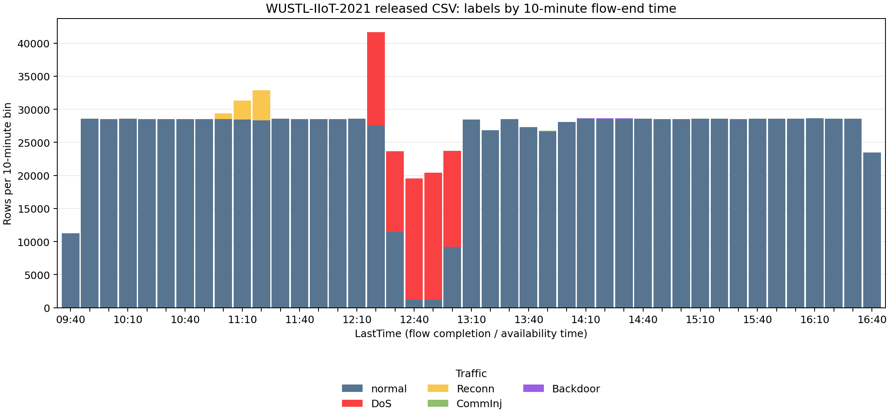

**What we did:** Audited time ordering, class support and feature availability before treating the dataset as a chronological evaluation stream.

**What the graph establishes:** Screens whether class support and chronology permit the intended evaluation. Dataset suitability is a separate question from model quality.

#### 3. APEX temporal and feature availability

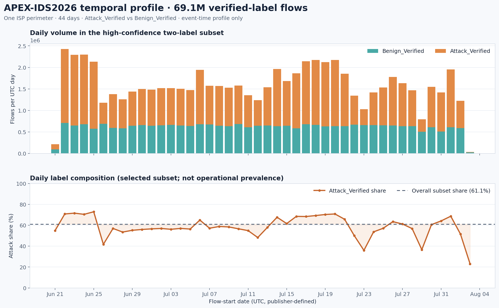

**What we did:** Audited time ordering, class support and feature availability before treating the dataset as a chronological evaluation stream.

**What the graph establishes:** Audits timeline/feature availability before replay. Availability artifacts must be distinguished from learned attack behavior.

#### 4. Reconnaissance pulse diagnostic

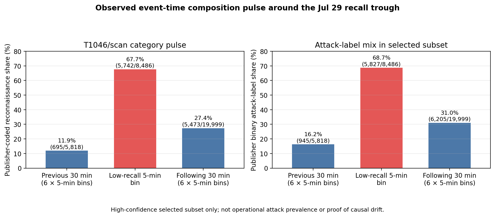

**What we did:** Ran the recorded diagnostic and inspected the relationship between traffic composition, detector errors and evaluation conditions.

**What the graph establishes:** Examines the relationship between campaign composition and errors. A concentrated pulse can distort pooled estimates; it is not a newly invented attack detector.

#### 5. Scanning observability on the fixed fitting sample

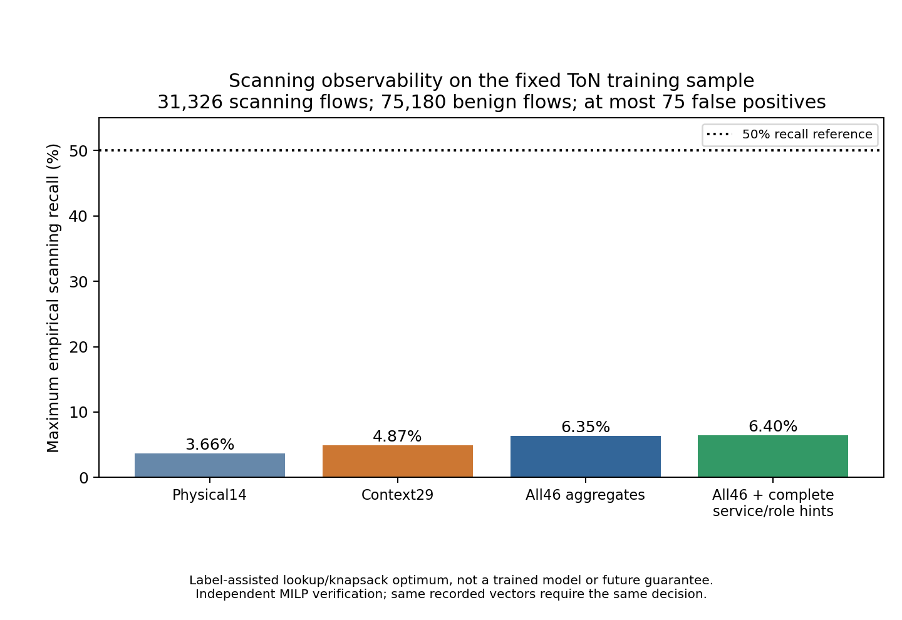

**What we did:** Grouped recorded feature vectors and quantified the best label-assisted empirical separation possible under the declared false-positive budget.

**What the graph establishes:** Measures label-assisted lookup optima for several recorded representations on the same fitting sample. Sample ceilings are not future guarantees; see the separate full-prefix audit.

#### 6. Raw-text full-prefix scanning bound

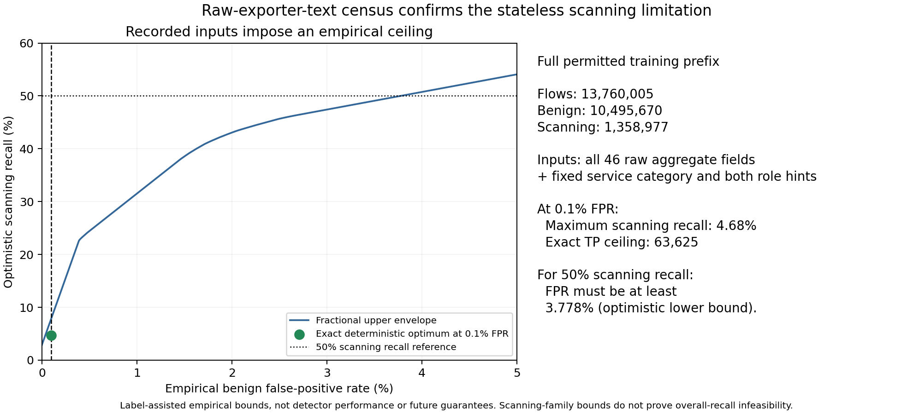

**What we did:** Grouped recorded feature vectors and quantified the best label-assisted empirical separation possible under the declared false-positive budget.

**What the graph establishes:** Audits 13,760,005 permitted training records. At 0.1% empirical FPR, complete recorded static descriptors permit at most 4.68% scanning recall. This is a family-specific empirical bound, not overall-IDS impossibility.

[Experiment implementation](conducted_experiments/09_data_integrity_and_observability.md) · [Full result page](results/09_data_integrity_and_observability.md)

</details>


## Installation and running

### 1. Install the core package

Use Python 3.10 or 3.11:

```bash
git clone https://github.com/SriharshithaSadhu/AutoShield-AI.git
cd AutoShield-AI
python -m venv .venv
```

Activate the environment:

```powershell
# Windows PowerShell
.venv\Scripts\Activate.ps1
```

```bash
# Linux / macOS
source .venv/bin/activate
```

```bash
python -m pip install -e .
python -m unittest discover -s tests -v
```

The core suite checks feature contracts, missing-value handling, strictly causal state, bounded memory, invalid-input rejection, batch-partition invariance with the bundled models, and optimizer comparison rules. Small engineering fixtures used by these tests are not detection-accuracy datasets.

### 2. Score completed flows

```bash
python examples/score_flows.py --input /path/to/flows.csv --model flow
python examples/score_flows.py --input /path/to/flows.csv --model hybrid --output outputs/hybrid_predictions.csv
```

Provide the [documented CSV schema](docs/data.md). The output columns are `row`, `arrival_ms`, `score` and `alert`. The scorer validates model checksums and preserves input order. It defaults to flow completion as an idealized receipt-time proxy; supply actual collector receipt timestamps with `--arrival-column` when available.

### 3. Evaluate a classifier configuration

```bash
python -m pip install -e ".[training]"
python examples/evaluate_model.py --data /path/to/training.csv --target Label --output outputs/evaluation.json
```

This example evaluates one fixed LightGBM configuration with grouped development folds. It is separate from running a full MOPSO search, which is exposed through `autoshield.automl.search_lightgbm_mopso` and documented in the source.

### 4. Inspect the adaptation runner

```bash
python experiments/replay_adaptation.py --help
```

Running the study requires the licensed CSE data and manifest described in [the data guide](docs/data.md). Historical runners require their recorded data/configuration and workspace layout; they are not automatically executed by the core examples or tests.

### 5. Regenerate the overview graphs

```bash
python -m pip install -e ".[plots]"
python docs/plot_results.py
```

This regenerates the two overview figures from saved JSON measurements. It does not refit a model or invent new measurements.

## Repository layout

```text
AutoShield-AI/
├── src/autoshield/                 Installable implementation
│   ├── automl.py                   Grouped candidate evaluation and search
│   ├── optimization.py             MOPSO, feasibility and Pareto archive
│   ├── preprocessing.py            Fold-local transforms and balancing
│   ├── evaluation.py               Quality, calibration and resource metrics
│   ├── observation.py              Bounded causal traffic histories
│   ├── features.py                 Common-exporter physical representation
│   ├── runtime.py                  Validated batch inference
│   └── scoring.py                  Native scoring helpers
├── examples/                       Inference and evaluation entry points
├── experiments/                    Adaptation study example
├── conducted_experiments/          Nine research-study indexes
│   ├── baseline_notebooks/         Reproduction code; figures extracted separately
│   ├── source/                     Preserved historical implementations
│   └── catalog.json                Source paths and checksums
├── results/
│   ├── README.md                   Results navigation
│   ├── graphs/                     All saved figures, grouped by study
│   ├── measurements/               Compact exports of recorded outcomes
│   ├── metrics.json                Full-tail flow/hybrid measurements
│   └── resource_benchmark.json      Desktop service/model-size evidence
├── models/                         Two frozen models and checksum manifest
├── tests/                          Data-independent engineering tests
├── docs/                           Data contract and plotting utility
└── .github/workflows/tests.yml     Continuous integration
```

## Reproducibility and evaluation

### Datasets and study roles

| Data source | Role in this project |
|---|---|
| CICIDS2017 | Base-pipeline reproduction and resource-aware candidate evaluation. |
| IoTID20 | Base-pipeline reproduction and source-model transfer studies. |
| CSE-CIC-IDS2018 | Chronological adaptation, label-delay and update-policy studies. |
| NF-ToN-IoT-v3 | Timestamped common-exporter development replay and behavioral studies. |
| NF-UNSW-NB15-v3 | Additional fitting/development environment with a separately protected suffix. |
| Additional screened/campaign sources | Data-suitability audits and explicitly scoped development comparisons; see the individual study pages. |

Raw data, packet captures, large per-flow caches and private credentials are excluded. Publisher links and the inference schema are in [docs/data.md](docs/data.md). Dataset reuse rights remain with the publishers.

### How we interpret the evidence

- Baseline notebook metrics and later chronological results use different protocols and are not treated as directly interchangeable.
- Learned preprocessing belongs inside the fitting folds; repeated vectors are grouped in development evaluation.
- Calibration, candidate selection and final/protected evaluation have distinct roles. The 473,085 protected UNSW rows remain unscored.
- ToN stress traffic was examined during development. These results are not presented as blind independent confirmation.
- Using ToN 2019 fitting data for an UNSW 2015 target is a retrospective cross-environment study, not calendar-causal deployment in 2015.
- Completed-flow order is a receipt-time proxy where actual exporter arrival timestamps are absent. A full dataset replay does not prove live-sensor visibility.
- Upper-confidence calibration assumptions and fixed-model empirical bounds are not promoted into unconditional guarantees under drift or repeated model selection.
- Positive and negative outcomes are retained so the repository shows both the working implementation and the limits established by its experiments.

### Current status

The project delivers a runnable IDS research implementation, reproducible evaluation components, a bounded streaming inference module, baseline reproduction and a substantial experiment collection. The engineering work demonstrates why deployment decisions must consider false alarms, resource cost and generalization together. Reliable operation at the strict low-FPR target across changing environments remains unresolved; current results support an experimental research prototype.

## Research foundation

The starting point is Yang & Shami, *Toward Autonomous and Efficient Cybersecurity: A Multi-Objective AutoML-based Intrusion Detection System*, IEEE Transactions on Machine Learning in Communications and Networking (2025).

- [Reference paper](https://doi.org/10.1109/TMLCN.2025.3631379)
- [Original implementation](https://github.com/Western-OC2-Lab/Multi-Objective-Optimization-AutoML-based-Intrusion-Detection-System)
- [Baseline reproduction notebooks](conducted_experiments/baseline_notebooks/)

The reference implementation, reproduced benchmark outputs and this project's engineering extensions are distinguished throughout the experiment and graph guides. Upstream software and dataset rights remain with their respective owners.
