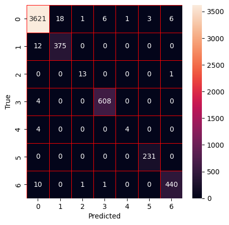
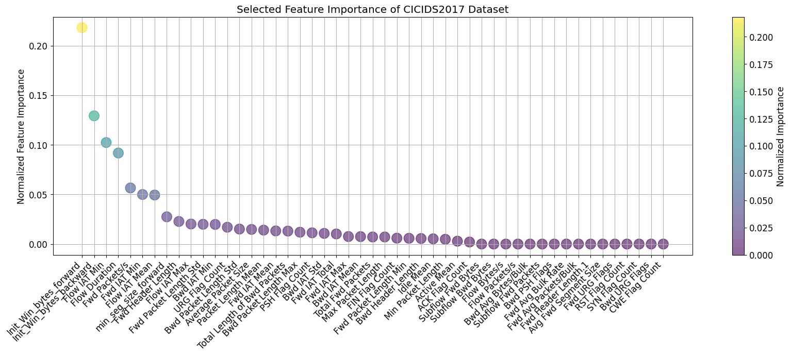
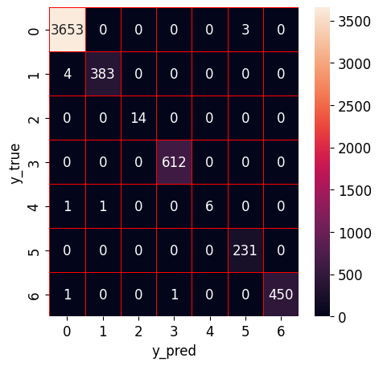
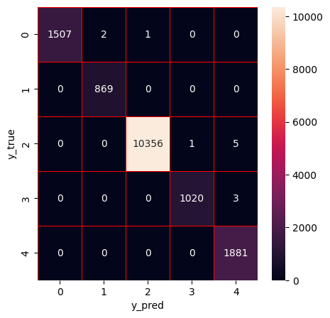
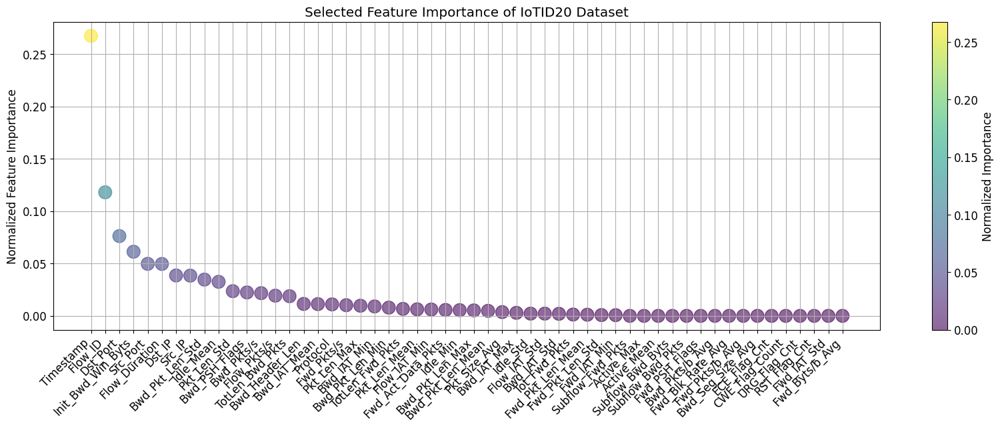
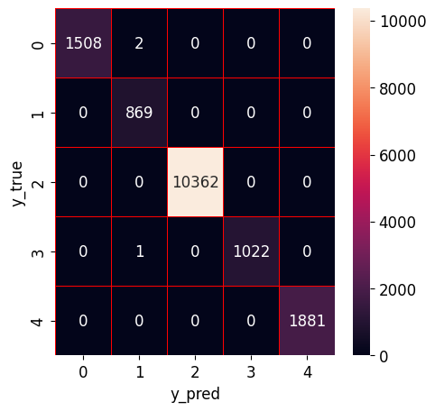

# Baseline reproduction: results and graphs

Reproduced benchmark pipelines on CICIDS2017 and IoTID20; compared tree models, balancing, feature selection and tuning. These are benchmark-split reproduction results, not new cross-network performance.

[Experiment implementations](../conducted_experiments/01_baseline_reproduction.md) · [All results](README.md)

## CICIDS2017 — Decision Tree baseline

**What the graph shows:** Saved reproduction confusion matrix: diagonal cells are correct classifications and off-diagonal cells expose class errors. This demonstrates the named benchmark stage, not cross-network generalization or superiority over other stages.

**Recorded source:** `MOO_AutoML_Dataset_1.ipynb, cell 17, output 1`

## CICIDS2017 — Random Forest baseline

**What the graph shows:** Saved reproduction confusion matrix: diagonal cells are correct classifications and off-diagonal cells expose class errors. This demonstrates the named benchmark stage, not cross-network generalization or superiority over other stages.

**Recorded source:** `MOO_AutoML_Dataset_1.ipynb, cell 19, output 1`

## CICIDS2017 — Extra Trees baseline

**What the graph shows:** Saved reproduction confusion matrix: diagonal cells are correct classifications and off-diagonal cells expose class errors. This demonstrates the named benchmark stage, not cross-network generalization or superiority over other stages.

**Recorded source:** `MOO_AutoML_Dataset_1.ipynb, cell 21, output 1`

## CICIDS2017 — LightGBM baseline

**What the graph shows:** Saved reproduction confusion matrix: diagonal cells are correct classifications and off-diagonal cells expose class errors. This demonstrates the named benchmark stage, not cross-network generalization or superiority over other stages.

**Recorded source:** `MOO_AutoML_Dataset_1.ipynb, cell 25, output 8`

## CICIDS2017 — LightGBM after balancing

**What the graph shows:** Saved reproduction confusion matrix: diagonal cells are correct classifications and off-diagonal cells expose class errors. This demonstrates the named benchmark stage, not cross-network generalization or superiority over other stages.

**Recorded source:** `MOO_AutoML_Dataset_1.ipynb, cell 30, output 4`

## CICIDS2017 — XGBoost after balancing

**What the graph shows:** Saved reproduction confusion matrix: diagonal cells are correct classifications and off-diagonal cells expose class errors. This demonstrates the named benchmark stage, not cross-network generalization or superiority over other stages.

**Recorded source:** `MOO_AutoML_Dataset_1.ipynb, cell 31, output 1`

## CICIDS2017 — Selected feature importance

**What the graph shows:** Saved reproduction output: ranks selected features; importance is not causal evidence.

**Recorded source:** `MOO_AutoML_Dataset_1.ipynb, cell 36, output 0`

## CICIDS2017 — LightGBM after feature selection

**What the graph shows:** Saved reproduction confusion matrix: diagonal cells are correct classifications and off-diagonal cells expose class errors. This demonstrates the named benchmark stage, not cross-network generalization or superiority over other stages.

**Recorded source:** `MOO_AutoML_Dataset_1.ipynb, cell 37, output 4`

## CICIDS2017 — XGBoost after feature selection

**What the graph shows:** Saved reproduction confusion matrix: diagonal cells are correct classifications and off-diagonal cells expose class errors. This demonstrates the named benchmark stage, not cross-network generalization or superiority over other stages.

**Recorded source:** `MOO_AutoML_Dataset_1.ipynb, cell 38, output 1`

## CICIDS2017 — Tuned LightGBM

**What the graph shows:** Saved reproduction confusion matrix: diagonal cells are correct classifications and off-diagonal cells expose class errors. This demonstrates the named benchmark stage, not cross-network generalization or superiority over other stages.

**Recorded source:** `MOO_AutoML_Dataset_1.ipynb, cell 44, output 2`

## CICIDS2017 — Tuned XGBoost

**What the graph shows:** Saved reproduction confusion matrix: diagonal cells are correct classifications and off-diagonal cells expose class errors. This demonstrates the named benchmark stage, not cross-network generalization or superiority over other stages.

**Recorded source:** `MOO_AutoML_Dataset_1.ipynb, cell 50, output 1`

## IoTID20 — Decision Tree baseline

**What the graph shows:** Saved reproduction confusion matrix: diagonal cells are correct classifications and off-diagonal cells expose class errors. This demonstrates the named benchmark stage, not cross-network generalization or superiority over other stages.

**Recorded source:** `MOO_AutoML_Dataset_2.ipynb, cell 17, output 1`

## IoTID20 — Random Forest baseline

**What the graph shows:** Saved reproduction confusion matrix: diagonal cells are correct classifications and off-diagonal cells expose class errors. This demonstrates the named benchmark stage, not cross-network generalization or superiority over other stages.

**Recorded source:** `MOO_AutoML_Dataset_2.ipynb, cell 19, output 1`

## IoTID20 — Extra Trees baseline

**What the graph shows:** Saved reproduction confusion matrix: diagonal cells are correct classifications and off-diagonal cells expose class errors. This demonstrates the named benchmark stage, not cross-network generalization or superiority over other stages.

**Recorded source:** `MOO_AutoML_Dataset_2.ipynb, cell 21, output 1`

## IoTID20 — XGBoost baseline

**What the graph shows:** Saved reproduction confusion matrix: diagonal cells are correct classifications and off-diagonal cells expose class errors. This demonstrates the named benchmark stage, not cross-network generalization or superiority over other stages.

**Recorded source:** `MOO_AutoML_Dataset_2.ipynb, cell 23, output 1`

## IoTID20 — LightGBM baseline

**What the graph shows:** Saved reproduction confusion matrix: diagonal cells are correct classifications and off-diagonal cells expose class errors. This demonstrates the named benchmark stage, not cross-network generalization or superiority over other stages.

**Recorded source:** `MOO_AutoML_Dataset_2.ipynb, cell 25, output 1`

## IoTID20 — LightGBM after balancing

**What the graph shows:** Saved reproduction confusion matrix: diagonal cells are correct classifications and off-diagonal cells expose class errors. This demonstrates the named benchmark stage, not cross-network generalization or superiority over other stages.

**Recorded source:** `MOO_AutoML_Dataset_2.ipynb, cell 30, output 1`

## IoTID20 — XGBoost after balancing

**What the graph shows:** Saved reproduction confusion matrix: diagonal cells are correct classifications and off-diagonal cells expose class errors. This demonstrates the named benchmark stage, not cross-network generalization or superiority over other stages.

**Recorded source:** `MOO_AutoML_Dataset_2.ipynb, cell 31, output 1`

## IoTID20 — Selected feature importance

**What the graph shows:** Saved reproduction output: ranks selected features; importance is not causal evidence.

**Recorded source:** `MOO_AutoML_Dataset_2.ipynb, cell 36, output 0`

## IoTID20 — LightGBM after feature selection

**What the graph shows:** Saved reproduction confusion matrix: diagonal cells are correct classifications and off-diagonal cells expose class errors. This demonstrates the named benchmark stage, not cross-network generalization or superiority over other stages.

**Recorded source:** `MOO_AutoML_Dataset_2.ipynb, cell 37, output 1`

## IoTID20 — XGBoost after feature selection

**What the graph shows:** Saved reproduction confusion matrix: diagonal cells are correct classifications and off-diagonal cells expose class errors. This demonstrates the named benchmark stage, not cross-network generalization or superiority over other stages.

**Recorded source:** `MOO_AutoML_Dataset_2.ipynb, cell 38, output 1`

## IoTID20 — Tuned LightGBM

**What the graph shows:** Saved reproduction confusion matrix: diagonal cells are correct classifications and off-diagonal cells expose class errors. This demonstrates the named benchmark stage, not cross-network generalization or superiority over other stages.

**Recorded source:** `MOO_AutoML_Dataset_2.ipynb, cell 44, output 1`

## IoTID20 — Tuned XGBoost

**What the graph shows:** Saved reproduction confusion matrix: diagonal cells are correct classifications and off-diagonal cells expose class errors. This demonstrates the named benchmark stage, not cross-network generalization or superiority over other stages.

**Recorded source:** `MOO_AutoML_Dataset_2.ipynb, cell 50, output 1`

