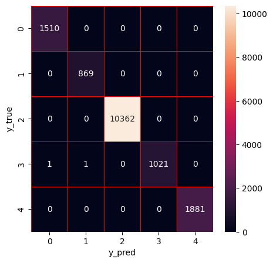
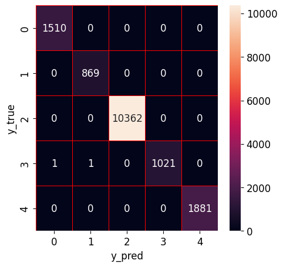

# Baseline reproduction: results and graphs

Reproduced benchmark pipelines on CICIDS2017 and IoTID20; compared tree models, balancing, feature selection and tuning. These are benchmark-split reproduction results, not new cross-network performance.

[Experiment implementations](../conducted_experiments/01_baseline_reproduction.md) · [All results](README.md)

## CICIDS2017 — Decision Tree baseline

**What we did:** Fitted the named conventional classifier as a baseline and plotted its confusion matrix on the notebook’s recorded evaluation split.

**What the graph establishes:** Saved reproduction confusion matrix: diagonal cells are correct classifications and off-diagonal cells expose class errors. This demonstrates the named benchmark stage, not cross-network generalization or superiority over other stages.

**Recorded metric:** The saved reference-notebook output reports accuracy **99.42%**, reported average F1 **0.9941**. These values belong to that notebook split and are not the later chronological replay results.

**Recorded source:** `MOO_AutoML_Dataset_1.ipynb, cell 17, output 1`

## CICIDS2017 — Random Forest baseline

**What we did:** Fitted the named conventional classifier as a baseline and plotted its confusion matrix on the notebook’s recorded evaluation split.

**What the graph establishes:** Saved reproduction confusion matrix: diagonal cells are correct classifications and off-diagonal cells expose class errors. This demonstrates the named benchmark stage, not cross-network generalization or superiority over other stages.

**Recorded metric:** The saved reference-notebook output reports accuracy **98.92%**, reported average F1 **0.9890**. These values belong to that notebook split and are not the later chronological replay results.

**Recorded source:** `MOO_AutoML_Dataset_1.ipynb, cell 19, output 1`

## CICIDS2017 — Extra Trees baseline

**What we did:** Fitted the named conventional classifier as a baseline and plotted its confusion matrix on the notebook’s recorded evaluation split.

**What the graph establishes:** Saved reproduction confusion matrix: diagonal cells are correct classifications and off-diagonal cells expose class errors. This demonstrates the named benchmark stage, not cross-network generalization or superiority over other stages.

**Recorded metric:** The saved reference-notebook output reports accuracy **98.73%**, reported average F1 **0.9872**. These values belong to that notebook split and are not the later chronological replay results.

**Recorded source:** `MOO_AutoML_Dataset_1.ipynb, cell 21, output 1`

## CICIDS2017 — LightGBM baseline

**What we did:** Fitted the named conventional classifier as a baseline and plotted its confusion matrix on the notebook’s recorded evaluation split.

**What the graph establishes:** Saved reproduction confusion matrix: diagonal cells are correct classifications and off-diagonal cells expose class errors. This demonstrates the named benchmark stage, not cross-network generalization or superiority over other stages.

**Recorded metric:** The saved reference-notebook output reports accuracy **99.66%**, reported average F1 **0.9965**. These values belong to that notebook split and are not the later chronological replay results.

**Recorded source:** `MOO_AutoML_Dataset_1.ipynb, cell 25, output 8`

## CICIDS2017 — LightGBM after balancing

**What we did:** Applied the notebook’s hybrid class-balancing stage, refitted the named classifier and inspected its class-level predictions.

**What the graph establishes:** Saved reproduction confusion matrix: diagonal cells are correct classifications and off-diagonal cells expose class errors. This demonstrates the named benchmark stage, not cross-network generalization or superiority over other stages.

**Recorded metric:** The saved reference-notebook output reports accuracy **99.76%**, reported average F1 **0.9975**. These values belong to that notebook split and are not the later chronological replay results.

**Recorded source:** `MOO_AutoML_Dataset_1.ipynb, cell 30, output 4`

## CICIDS2017 — XGBoost after balancing

**What we did:** Applied the notebook’s hybrid class-balancing stage, refitted the named classifier and inspected its class-level predictions.

**What the graph establishes:** Saved reproduction confusion matrix: diagonal cells are correct classifications and off-diagonal cells expose class errors. This demonstrates the named benchmark stage, not cross-network generalization or superiority over other stages.

**Recorded metric:** The saved reference-notebook output reports accuracy **99.74%**, reported average F1 **0.9974**. These values belong to that notebook split and are not the later chronological replay results.

**Recorded source:** `MOO_AutoML_Dataset_1.ipynb, cell 31, output 1`

## CICIDS2017 — Selected feature importance

**What we did:** Ran the feature-selection stage and plotted the retained features and their normalized importance.

**What the graph establishes:** Saved reproduction output: ranks selected features; importance is not causal evidence.

**Recorded source:** `MOO_AutoML_Dataset_1.ipynb, cell 36, output 0`

## CICIDS2017 — LightGBM after feature selection

**What we did:** Refitted the named classifier on the selected feature subset to examine the effect of the feature-selection stage.

**What the graph establishes:** Saved reproduction confusion matrix: diagonal cells are correct classifications and off-diagonal cells expose class errors. This demonstrates the named benchmark stage, not cross-network generalization or superiority over other stages.

**Recorded metric:** The saved reference-notebook output reports accuracy **99.79%**, reported average F1 **0.9979**. These values belong to that notebook split and are not the later chronological replay results.

**Recorded source:** `MOO_AutoML_Dataset_1.ipynb, cell 37, output 4`

## CICIDS2017 — XGBoost after feature selection

**What we did:** Refitted the named classifier on the selected feature subset to examine the effect of the feature-selection stage.

**What the graph establishes:** Saved reproduction confusion matrix: diagonal cells are correct classifications and off-diagonal cells expose class errors. This demonstrates the named benchmark stage, not cross-network generalization or superiority over other stages.

**Recorded metric:** The saved reference-notebook output reports accuracy **99.76%**, reported average F1 **0.9975**. These values belong to that notebook split and are not the later chronological replay results.

**Recorded source:** `MOO_AutoML_Dataset_1.ipynb, cell 38, output 1`

## CICIDS2017 — Tuned LightGBM

**What we did:** Ran the notebook’s configuration-optimization stage and plotted the tuned classifier’s class-level predictions.

**What the graph establishes:** Saved reproduction confusion matrix: diagonal cells are correct classifications and off-diagonal cells expose class errors. This demonstrates the named benchmark stage, not cross-network generalization or superiority over other stages.

**Recorded metric:** The saved reference-notebook output reports accuracy **99.72%**, reported average F1 **0.9972**. These values belong to that notebook split and are not the later chronological replay results.

**Recorded source:** `MOO_AutoML_Dataset_1.ipynb, cell 44, output 2`

## CICIDS2017 — Tuned XGBoost

**What we did:** Ran the notebook’s configuration-optimization stage and plotted the tuned classifier’s class-level predictions.

**What the graph establishes:** Saved reproduction confusion matrix: diagonal cells are correct classifications and off-diagonal cells expose class errors. This demonstrates the named benchmark stage, not cross-network generalization or superiority over other stages.

**Recorded metric:** The saved reference-notebook output reports accuracy **99.76%**, reported average F1 **0.9975**. These values belong to that notebook split and are not the later chronological replay results.

**Recorded source:** `MOO_AutoML_Dataset_1.ipynb, cell 50, output 1`

## IoTID20 — Decision Tree baseline

**What we did:** Fitted the named conventional classifier as a baseline and plotted its confusion matrix on the notebook’s recorded evaluation split.

**What the graph establishes:** Saved reproduction confusion matrix: diagonal cells are correct classifications and off-diagonal cells expose class errors. This demonstrates the named benchmark stage, not cross-network generalization or superiority over other stages.

**Recorded metric:** The saved reference-notebook output reports accuracy **99.97%**, reported average F1 **0.9997**. These values belong to that notebook split and are not the later chronological replay results.

**Recorded source:** `MOO_AutoML_Dataset_2.ipynb, cell 17, output 1`

## IoTID20 — Random Forest baseline

**What we did:** Fitted the named conventional classifier as a baseline and plotted its confusion matrix on the notebook’s recorded evaluation split.

**What the graph establishes:** Saved reproduction confusion matrix: diagonal cells are correct classifications and off-diagonal cells expose class errors. This demonstrates the named benchmark stage, not cross-network generalization or superiority over other stages.

**Recorded metric:** The saved reference-notebook output reports accuracy **99.22%**, reported average F1 **0.9922**. These values belong to that notebook split and are not the later chronological replay results.

**Recorded source:** `MOO_AutoML_Dataset_2.ipynb, cell 19, output 1`

## IoTID20 — Extra Trees baseline

**What we did:** Fitted the named conventional classifier as a baseline and plotted its confusion matrix on the notebook’s recorded evaluation split.

**What the graph establishes:** Saved reproduction confusion matrix: diagonal cells are correct classifications and off-diagonal cells expose class errors. This demonstrates the named benchmark stage, not cross-network generalization or superiority over other stages.

**Recorded metric:** The saved reference-notebook output reports accuracy **98.52%**, reported average F1 **0.9851**. These values belong to that notebook split and are not the later chronological replay results.

**Recorded source:** `MOO_AutoML_Dataset_2.ipynb, cell 21, output 1`

## IoTID20 — XGBoost baseline

**What we did:** Fitted the named conventional classifier as a baseline and plotted its confusion matrix on the notebook’s recorded evaluation split.

**What the graph establishes:** Saved reproduction confusion matrix: diagonal cells are correct classifications and off-diagonal cells expose class errors. This demonstrates the named benchmark stage, not cross-network generalization or superiority over other stages.

**Recorded metric:** The saved reference-notebook output reports accuracy **99.99%**, reported average F1 **0.9999**. These values belong to that notebook split and are not the later chronological replay results.

**Recorded source:** `MOO_AutoML_Dataset_2.ipynb, cell 23, output 1`

## IoTID20 — LightGBM baseline

**What we did:** Fitted the named conventional classifier as a baseline and plotted its confusion matrix on the notebook’s recorded evaluation split.

**What the graph establishes:** Saved reproduction confusion matrix: diagonal cells are correct classifications and off-diagonal cells expose class errors. This demonstrates the named benchmark stage, not cross-network generalization or superiority over other stages.

**Recorded metric:** The saved reference-notebook output reports accuracy **99.92%**, reported average F1 **0.9992**. These values belong to that notebook split and are not the later chronological replay results.

**Recorded source:** `MOO_AutoML_Dataset_2.ipynb, cell 25, output 1`

## IoTID20 — LightGBM after balancing

**What we did:** Applied the notebook’s hybrid class-balancing stage, refitted the named classifier and inspected its class-level predictions.

**What the graph establishes:** Saved reproduction confusion matrix: diagonal cells are correct classifications and off-diagonal cells expose class errors. This demonstrates the named benchmark stage, not cross-network generalization or superiority over other stages.

**Recorded metric:** The saved reference-notebook output reports accuracy **99.96%**, reported average F1 **0.9996**. These values belong to that notebook split and are not the later chronological replay results.

**Recorded source:** `MOO_AutoML_Dataset_2.ipynb, cell 30, output 1`

## IoTID20 — XGBoost after balancing

**What we did:** Applied the notebook’s hybrid class-balancing stage, refitted the named classifier and inspected its class-level predictions.

**What the graph establishes:** Saved reproduction confusion matrix: diagonal cells are correct classifications and off-diagonal cells expose class errors. This demonstrates the named benchmark stage, not cross-network generalization or superiority over other stages.

**Recorded metric:** The saved reference-notebook output reports accuracy **99.99%**, reported average F1 **0.9999**. These values belong to that notebook split and are not the later chronological replay results.

**Recorded source:** `MOO_AutoML_Dataset_2.ipynb, cell 31, output 1`

## IoTID20 — Selected feature importance

**What we did:** Ran the feature-selection stage and plotted the retained features and their normalized importance.

**What the graph establishes:** Saved reproduction output: ranks selected features; importance is not causal evidence.

**Recorded source:** `MOO_AutoML_Dataset_2.ipynb, cell 36, output 0`

## IoTID20 — LightGBM after feature selection

**What we did:** Refitted the named classifier on the selected feature subset to examine the effect of the feature-selection stage.

**What the graph establishes:** Saved reproduction confusion matrix: diagonal cells are correct classifications and off-diagonal cells expose class errors. This demonstrates the named benchmark stage, not cross-network generalization or superiority over other stages.

**Recorded metric:** The saved reference-notebook output reports accuracy **99.98%**, reported average F1 **0.9998**. These values belong to that notebook split and are not the later chronological replay results.

**Recorded source:** `MOO_AutoML_Dataset_2.ipynb, cell 37, output 1`

## IoTID20 — XGBoost after feature selection

**What we did:** Refitted the named classifier on the selected feature subset to examine the effect of the feature-selection stage.

**What the graph establishes:** Saved reproduction confusion matrix: diagonal cells are correct classifications and off-diagonal cells expose class errors. This demonstrates the named benchmark stage, not cross-network generalization or superiority over other stages.

**Recorded metric:** The saved reference-notebook output reports accuracy **99.99%**, reported average F1 **0.9999**. These values belong to that notebook split and are not the later chronological replay results.

**Recorded source:** `MOO_AutoML_Dataset_2.ipynb, cell 38, output 1`

## IoTID20 — Tuned LightGBM

**What we did:** Ran the notebook’s configuration-optimization stage and plotted the tuned classifier’s class-level predictions.

**What the graph establishes:** Saved reproduction confusion matrix: diagonal cells are correct classifications and off-diagonal cells expose class errors. This demonstrates the named benchmark stage, not cross-network generalization or superiority over other stages.

**Recorded metric:** The saved reference-notebook output reports accuracy **99.99%**, reported average F1 **0.9999**. These values belong to that notebook split and are not the later chronological replay results.

**Recorded source:** `MOO_AutoML_Dataset_2.ipynb, cell 44, output 1`

## IoTID20 — Tuned XGBoost

**What we did:** Ran the notebook’s configuration-optimization stage and plotted the tuned classifier’s class-level predictions.

**What the graph establishes:** Saved reproduction confusion matrix: diagonal cells are correct classifications and off-diagonal cells expose class errors. This demonstrates the named benchmark stage, not cross-network generalization or superiority over other stages.

**Recorded metric:** The saved reference-notebook output reports accuracy **99.99%**, reported average F1 **0.9999**. These values belong to that notebook split and are not the later chronological replay results.

**Recorded source:** `MOO_AutoML_Dataset_2.ipynb, cell 50, output 1`

