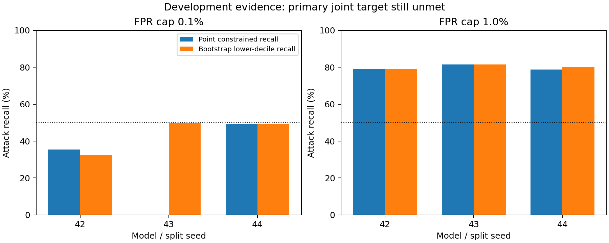

# AutoML and resource constraints: results and graphs

Implemented Pareto archives, feasibility-first search, repeated seeds and matched optimizer comparisons. Results do not establish consistent MOPSO superiority; measured compute and feasibility accompany quality metrics.

[Experiment implementations](../conducted_experiments/02_automl_and_resource_constraints.md) · [All results](README.md)

## Selection stability under budget constraints

**What the graph shows:** Checks the stability of candidate selection and calibrated operating points. The primary combined recall/FPR requirement was not reliably met.

**Recorded source:** `selection_stability/comparison.png`

## Recorded measurements

Open the compact measured outputs

- [cicids2017_lightgbm_mopso_constraint_blind_dev_seed42.json](measurements/02_automl_and_resource_constraints/cicids2017_lightgbm_mopso_constraint_blind_dev_seed42.json)
- [cicids2017_lightgbm_mopso_constraint_blind_dev_seed43.json](measurements/02_automl_and_resource_constraints/cicids2017_lightgbm_mopso_constraint_blind_dev_seed43.json)
- [cicids2017_lightgbm_mopso_dev_seed42.json](measurements/02_automl_and_resource_constraints/cicids2017_lightgbm_mopso_dev_seed42.json)
- [cicids2017_lightgbm_mopso_feasibility_first_dev_seed42.json](measurements/02_automl_and_resource_constraints/cicids2017_lightgbm_mopso_feasibility_first_dev_seed42.json)
- [cicids2017_lightgbm_mopso_feasibility_first_dev_seed43.json](measurements/02_automl_and_resource_constraints/cicids2017_lightgbm_mopso_feasibility_first_dev_seed43.json)
- [iotid20_binary_common77_mopso_seed42.json](measurements/02_automl_and_resource_constraints/iotid20_binary_common77_mopso_seed42.json)
- [iotid20_lightgbm_mopso_constraint_blind_dev_seed42.json](measurements/02_automl_and_resource_constraints/iotid20_lightgbm_mopso_constraint_blind_dev_seed42.json)
- [iotid20_lightgbm_mopso_constraint_blind_dev_seed43.json](measurements/02_automl_and_resource_constraints/iotid20_lightgbm_mopso_constraint_blind_dev_seed43.json)
- [iotid20_lightgbm_mopso_dev_seed42.json](measurements/02_automl_and_resource_constraints/iotid20_lightgbm_mopso_dev_seed42.json)
- [iotid20_lightgbm_mopso_feasibility_first_dev_seed42.json](measurements/02_automl_and_resource_constraints/iotid20_lightgbm_mopso_feasibility_first_dev_seed42.json)
- [iotid20_lightgbm_mopso_feasibility_first_dev_seed43.json](measurements/02_automl_and_resource_constraints/iotid20_lightgbm_mopso_feasibility_first_dev_seed43.json)
- [matched_selection/results.json](measurements/02_automl_and_resource_constraints/matched_selection__results.json)
- [matched_selection_budget_forests/results.json](measurements/02_automl_and_resource_constraints/matched_selection_budget_forests__results.json)
- [mopso_constraint_ablation_cicids_seed42_partial.json](measurements/02_automl_and_resource_constraints/mopso_constraint_ablation_cicids_seed42_partial.json)
- [mopso_constraint_ablation_cicids_seed43_partial.json](measurements/02_automl_and_resource_constraints/mopso_constraint_ablation_cicids_seed43_partial.json)
- [mopso_constraint_ablation_seed42.json](measurements/02_automl_and_resource_constraints/mopso_constraint_ablation_seed42.json)
- [mopso_vs_random_resource_profiles_seed42.json](measurements/02_automl_and_resource_constraints/mopso_vs_random_resource_profiles_seed42.json)
- [selection_stability/results.json](measurements/02_automl_and_resource_constraints/selection_stability__results.json)

