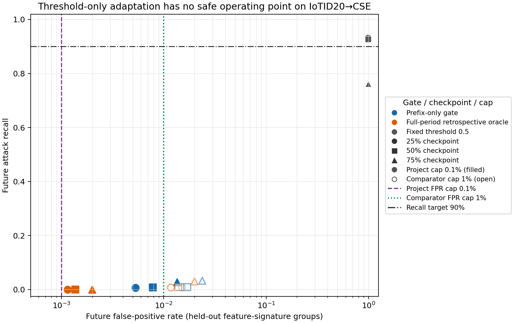
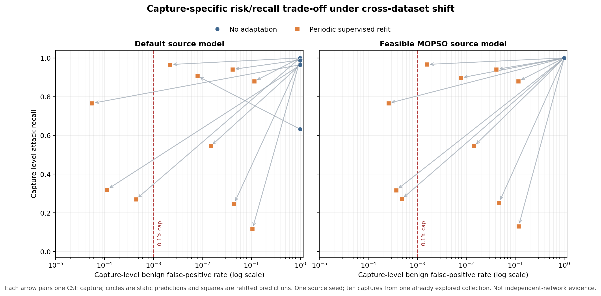

# Cross-dataset transfer: results and graphs

Audited feature compatibility and tested source-to-target transfer. Per-capture false alarms and recall reveal failures that pooled scores can conceal.

[Experiment implementations](../conducted_experiments/03_cross_dataset_transfer.md) · [All results](README.md)

## Transfer threshold-gate feasibility

**What the graph shows:** Tests whether transferred scores support the declared recall and false-positive budgets. Failed operating points remain visible; threshold control alone is insufficient.

**Recorded source:** `IOTID20_CSE_THRESHOLD_GATE_TRADEOFF.png`

## Transfer risk by capture

**What the graph shows:** Separates capture-specific recall and false alarms rather than treating pooled performance as deployment safety.

**Recorded source:** `IOTID20_CSE_TRANSFER_CAPTURE_RISK_TRADEOFF.png`

