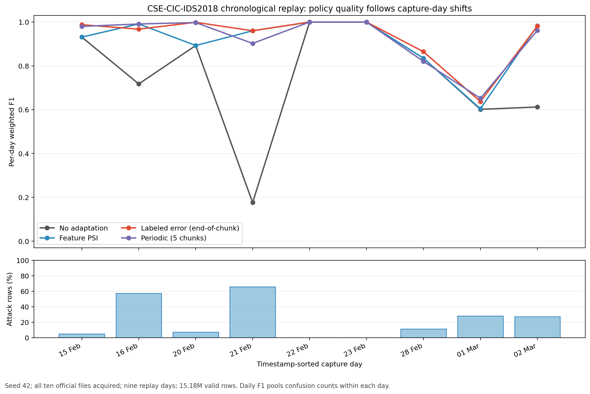
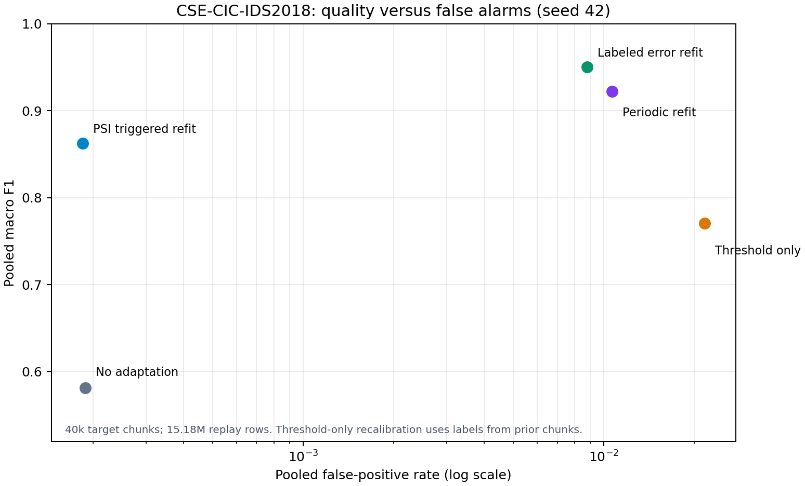
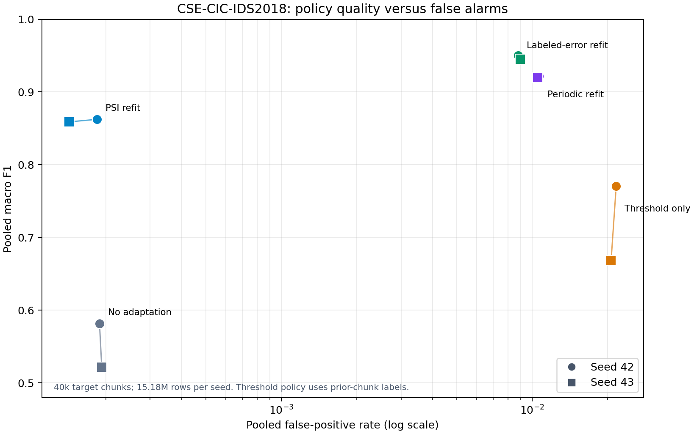
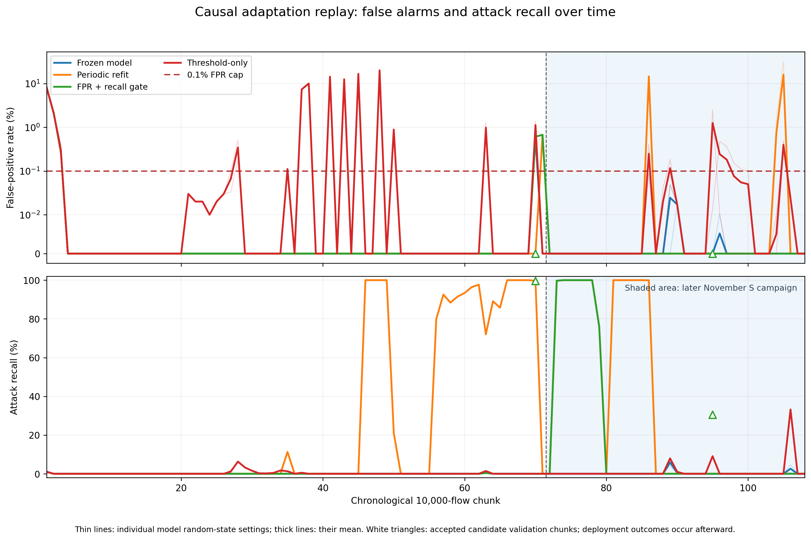
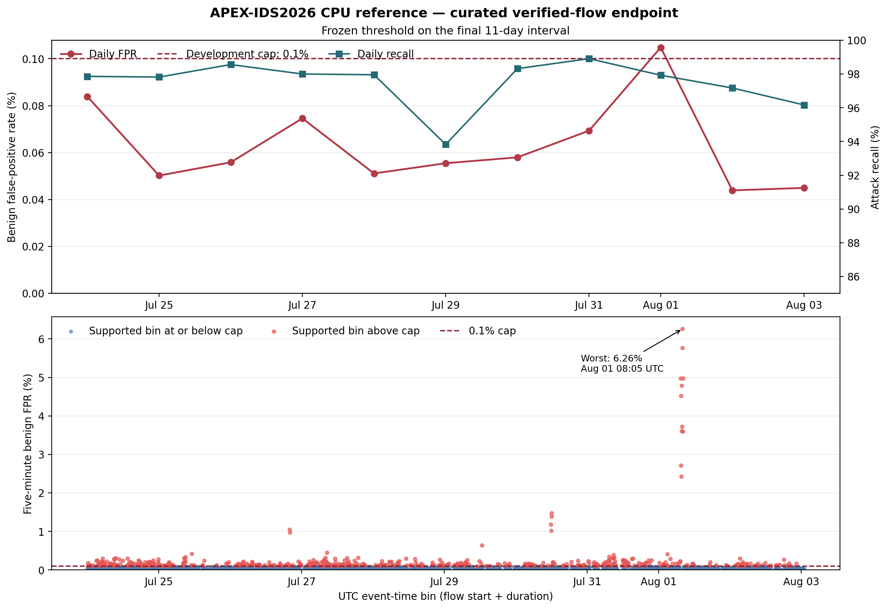

# Chronological adaptation: results and graphs

Compared frozen, periodic, drift-triggered and threshold-update policies on ordered traffic. Adaptation can recover detection while introducing capture-level false-alarm risk.

[Experiment implementations](../conducted_experiments/04_temporal_adaptation.md) · [All results](README.md)

## CSE adaptation across capture days

**What we did:** Scored chronologically ordered traffic with frozen and update-policy baselines and compared behavior across days or chunks.

**What the graph establishes:** Compares daily F1 across frozen and update policies. Performance varies by capture; a pooled adaptation gain does not establish uniform safety.

**Recorded source:** `cse_daily_policy_f1_seed42.png`

## Threshold recalibration, seed 42

**What we did:** Evaluated threshold policies against recall and false-positive requirements rather than selecting on F1 alone.

**What the graph establishes:** Shows the recall/false-alarm tradeoff from threshold-only changes. Recalibration is distinct from improving the score ranking.

**Recorded source:** `cse_threshold_recalibration_tradeoff_seed42.png`

## Threshold recalibration across two seeds

**What we did:** Evaluated threshold policies against recall and false-positive requirements rather than selecting on F1 alone.

**What the graph establishes:** Checks whether the same-stream tradeoff changes with model seed. Repeated seeds are not independent-network validation.

**Recorded source:** `cse_threshold_recalibration_tradeoff_seeds42_43.png`

## Smart-factory chronological replay

**What we did:** Scored chronologically ordered traffic with frozen and update-policy baselines and compared behavior across days or chunks.

**What the graph establishes:** Compares policies over successive chunks. A low-FPR policy can still lose useful attack detections; family and chunk behavior must accompany pooled metrics.

**Recorded source:** `smart_factory_a_to_s_chunk_metrics.png`

## APEX frozen-model replay

**What we did:** Kept the model fixed and measured its detection behavior over successive temporal periods without attributing the outcome to adaptation.

**What the graph establishes:** Measures fixed-model behavior across temporal segments. This is additional development evidence, not a successful adaptation or independent-confirmation claim.

**Recorded source:** `APEX_IDS2026_NO_UPDATE_TEMPORAL_RESULTS.png`

## Recorded measurements

Open the compact measured outputs

- [cse_cic_ids2018_adaptation_all10_seed42.json](measurements/04_temporal_adaptation/cse_cic_ids2018_adaptation_all10_seed42.json)
- [cse_cic_ids2018_adaptation_all10_seed42_chunk40k.json](measurements/04_temporal_adaptation/cse_cic_ids2018_adaptation_all10_seed42_chunk40k.json)
- [cse_cic_ids2018_adaptation_all10_seed42_fpr_capped_dev.json](measurements/04_temporal_adaptation/cse_cic_ids2018_adaptation_all10_seed42_fpr_capped_dev.json)
- [cse_cic_ids2018_adaptation_all10_seed42_fpr_capped_dev_analysis.json](measurements/04_temporal_adaptation/cse_cic_ids2018_adaptation_all10_seed42_fpr_capped_dev_analysis.json)
- [cse_cic_ids2018_adaptation_all10_seed42_psi99.json](measurements/04_temporal_adaptation/cse_cic_ids2018_adaptation_all10_seed42_psi99.json)
- [cse_cic_ids2018_adaptation_all10_seed42_threshold.json](measurements/04_temporal_adaptation/cse_cic_ids2018_adaptation_all10_seed42_threshold.json)
- [cse_cic_ids2018_adaptation_all10_seed43.json](measurements/04_temporal_adaptation/cse_cic_ids2018_adaptation_all10_seed43.json)
- [cse_cic_ids2018_adaptation_all10_seed43_fpr_capped_dev.json](measurements/04_temporal_adaptation/cse_cic_ids2018_adaptation_all10_seed43_fpr_capped_dev.json)
- [cse_cic_ids2018_adaptation_all10_seed43_fpr_capped_dev_analysis.json](measurements/04_temporal_adaptation/cse_cic_ids2018_adaptation_all10_seed43_fpr_capped_dev_analysis.json)
- [cse_cic_ids2018_adaptation_all10_seed43_threshold.json](measurements/04_temporal_adaptation/cse_cic_ids2018_adaptation_all10_seed43_threshold.json)
- [SMART_FACTORY_A_TO_S_REPLAY.json](measurements/04_temporal_adaptation/SMART_FACTORY_A_TO_S_REPLAY.json)

