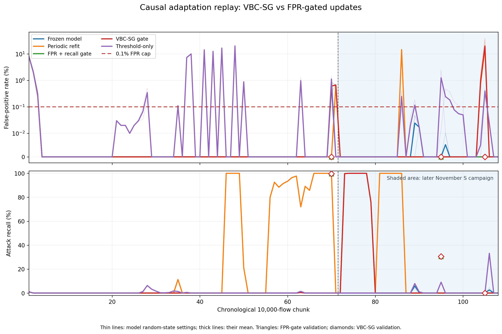

# Delayed feedback and streaming safeguards: results and graphs

Evaluated label delays, approval, rollback, recovery and deadline batching. The work measures harmful updates, missed attacks, switching and delivery cost; it does not establish a universally safe update controller.

[Experiment implementations](../conducted_experiments/05_delayed_feedback_and_safeguards.md) · [All results](README.md)

## Validate-before-commit comparison

**What the graph shows:** Evaluates source-method admission and an FPR-oriented gate on a shared campaign. This is a same-stream development comparison; label-evidence budgets are not fully matched.

**Recorded source:** `smart_factory_a_to_s_vbc_comparison.png`

## Recorded measurements

Open the compact measured outputs

- [corrected_cse_gate/deadline_delay0.json](measurements/05_delayed_feedback_and_safeguards/corrected_cse_gate__deadline_delay0.json)
- [corrected_cse_gate/deadline_delay4.json](measurements/05_delayed_feedback_and_safeguards/corrected_cse_gate__deadline_delay4.json)
- [corrected_cse_gate/deadline_evidence1000_delay4.json](measurements/05_delayed_feedback_and_safeguards/corrected_cse_gate__deadline_evidence1000_delay4.json)
- [corrected_cse_gate/deadline_failure_attribution.json](measurements/05_delayed_feedback_and_safeguards/corrected_cse_gate__deadline_failure_attribution.json)
- [corrected_cse_gate/deadline_recovery_summary.json](measurements/05_delayed_feedback_and_safeguards/corrected_cse_gate__deadline_recovery_summary.json)
- [corrected_cse_gate/nf_ton_deadline_failure_attribution.json](measurements/05_delayed_feedback_and_safeguards/corrected_cse_gate__nf_ton_deadline_failure_attribution.json)
- [corrected_cse_gate/recovery_delay0_1000.json](measurements/05_delayed_feedback_and_safeguards/corrected_cse_gate__recovery_delay0_1000.json)
- [corrected_cse_gate/recovery_delay0_3000.json](measurements/05_delayed_feedback_and_safeguards/corrected_cse_gate__recovery_delay0_3000.json)
- [corrected_cse_gate/recovery_delay4_1000.json](measurements/05_delayed_feedback_and_safeguards/corrected_cse_gate__recovery_delay4_1000.json)
- [corrected_cse_gate/recovery_delay4_3000.json](measurements/05_delayed_feedback_and_safeguards/corrected_cse_gate__recovery_delay4_3000.json)
- [desktop_bundle_comparison/deadline_pipeline_desktop.json](measurements/05_delayed_feedback_and_safeguards/desktop_bundle_comparison__deadline_pipeline_desktop.json)
- [desktop_bundle_comparison/deadline_recovery_desktop.json](measurements/05_delayed_feedback_and_safeguards/desktop_bundle_comparison__deadline_recovery_desktop.json)
- [SMART_FACTORY_A_TO_S_VBC_COMPARISON.json](measurements/05_delayed_feedback_and_safeguards/SMART_FACTORY_A_TO_S_VBC_COMPARISON.json)

