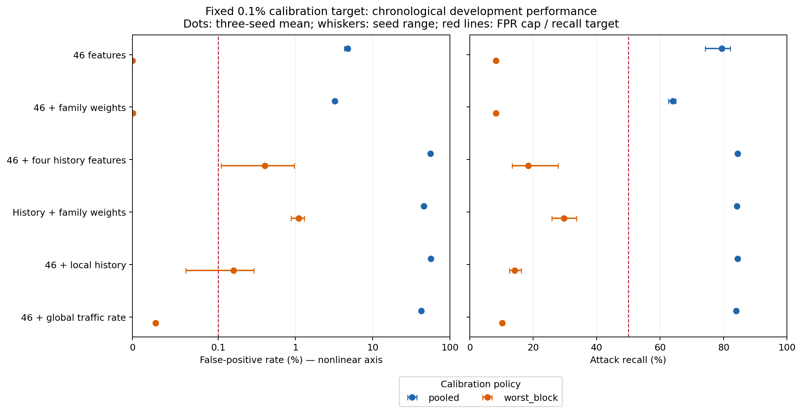
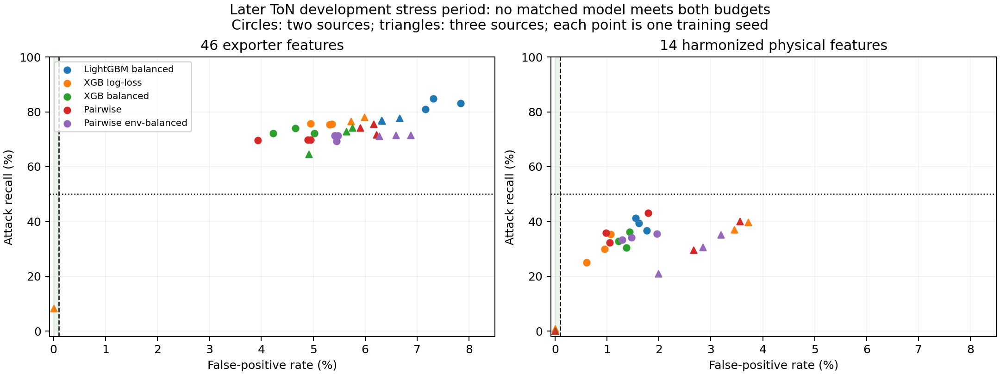
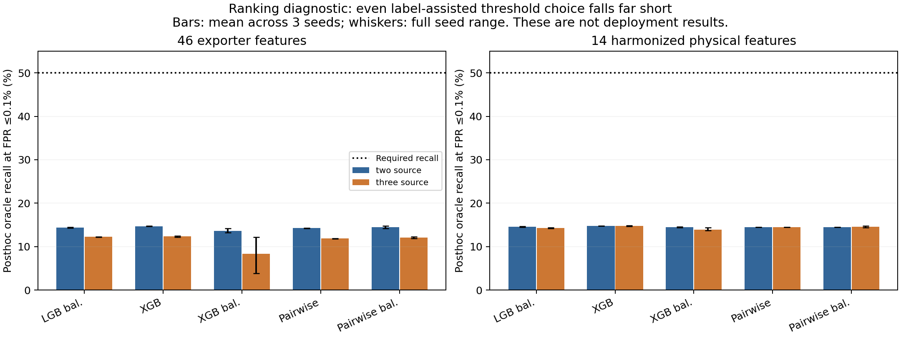
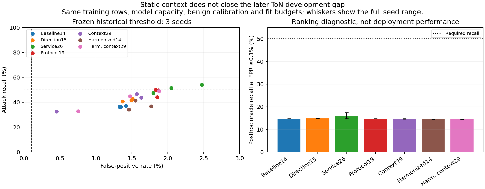
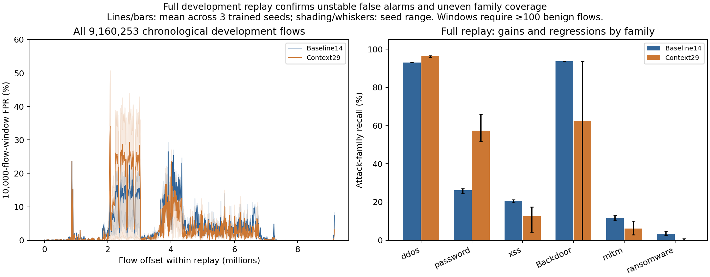

# Generalization and network context: results and graphs

Compared single- and multi-environment fitting, robust/group-aware controls and legitimate service/direction context. Later-period performance remains below the joint recall/FPR requirement.

[Experiment implementations](../conducted_experiments/07_generalization_and_context.md) · [All results](README.md)

## Context representation ablation

**What the graph shows:** Separates representation effects across chronological windows and selection rules. Context additions do not automatically restore feasibility.

**Recorded source:** `generalization_study_2026-11-19/context_ablation.png`

## Matched multi-environment fitting

**What the graph shows:** Compares training exposure under matched conditions. Nearby-period gains do not guarantee later-period low-FPR generalization.

**Recorded source:** `multienvironment_2026-11-21/matched_generalization_tradeoff.png`

## Low-FPR ranking limits

**What the graph shows:** Uses retrospective labels to diagnose recall achievable from fitted scores at fixed FPR. These thresholds are not deployable or used for protected tuning.

**Recorded source:** `multienvironment_2026-11-21/matched_low_fpr_ranking_diagnostic.png`

## Service, direction and protocol context

**What the graph shows:** Compares causal contextual representations with the flow baseline. None of these contextual variants restored the required later-period joint operating point.

**Recorded source:** `network_context_2026-11-21/context_features_tradeoff.png`

## Full-density contextual tail risk

**What the graph shows:** Shows how errors vary over real chronological windows. Worst-window false alarms can remain severe even when pooled metrics look less extreme.

**Recorded source:** `network_context_2026-11-21/full_context_window_risk.png`

## Recorded measurements

Open the compact measured outputs

- [causal_context_ablation/results.json](measurements/07_generalization_and_context/causal_context_ablation__results.json)
- [causal_context_components/results.json](measurements/07_generalization_and_context/causal_context_components__results.json)
- [context_full_period/results.json](measurements/07_generalization_and_context/context_full_period__results.json)
- [detection_foundation/results.json](measurements/07_generalization_and_context/detection_foundation__results.json)
- [generalization_evaluator/results.json](measurements/07_generalization_and_context/generalization_evaluator__results.json)
- [generalization_evaluator_v2/results.json](measurements/07_generalization_and_context/generalization_evaluator_v2__results.json)
- [generalization_evaluator_v3/results.json](measurements/07_generalization_and_context/generalization_evaluator_v3__results.json)
- [multienvironment_2026-11-21/calibration_margin/results.json](measurements/07_generalization_and_context/multienvironment_2026-11-21__calibration_margin__results.json)
- [multienvironment_2026-11-21/harmonization/calibration_margin/results.json](measurements/07_generalization_and_context/multienvironment_2026-11-21__harmonization__calibration_margin__results.json)
- [multienvironment_2026-11-21/harmonization/network_calibration/results.json](measurements/07_generalization_and_context/multienvironment_2026-11-21__harmonization__network_calibration__results.json)
- [multienvironment_2026-11-21/harmonization/results.json](measurements/07_generalization_and_context/multienvironment_2026-11-21__harmonization__results.json)
- [multienvironment_2026-11-21/matched_lightgbm_objective_reference/results.json](measurements/07_generalization_and_context/multienvironment_2026-11-21__matched_lightgbm_objective_reference__results.json)
- [multienvironment_2026-11-21/network_calibration/results.json](measurements/07_generalization_and_context/multienvironment_2026-11-21__network_calibration__results.json)
- [multienvironment_2026-11-21/ranking_objective/results.json](measurements/07_generalization_and_context/multienvironment_2026-11-21__ranking_objective__results.json)
- [multienvironment_2026-11-21/results.json](measurements/07_generalization_and_context/multienvironment_2026-11-21__results.json)
- [multienvironment_2026-11-21/source_coverage_pilot/results.json](measurements/07_generalization_and_context/multienvironment_2026-11-21__source_coverage_pilot__results.json)
- [network_context_2026-11-21/fixed_fit_control/results.json](measurements/07_generalization_and_context/network_context_2026-11-21__fixed_fit_control__results.json)
- [network_context_2026-11-21/full_development_replay/results.json](measurements/07_generalization_and_context/network_context_2026-11-21__full_development_replay__results.json)
- [network_context_2026-11-21/full_training_role_text_audit/results.json](measurements/07_generalization_and_context/network_context_2026-11-21__full_training_role_text_audit__results.json)
- [network_context_2026-11-21/full_training_text_audit/results.json](measurements/07_generalization_and_context/network_context_2026-11-21__full_training_text_audit__results.json)
- [network_context_2026-11-21/prefix_coverage_control/results.json](measurements/07_generalization_and_context/network_context_2026-11-21__prefix_coverage_control__results.json)
- [network_context_2026-11-21/results.json](measurements/07_generalization_and_context/network_context_2026-11-21__results.json)
- [representation_selection/results.json](measurements/07_generalization_and_context/representation_selection__results.json)

