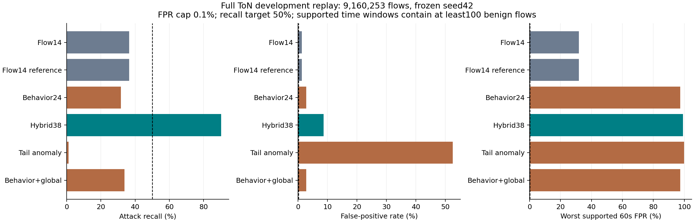
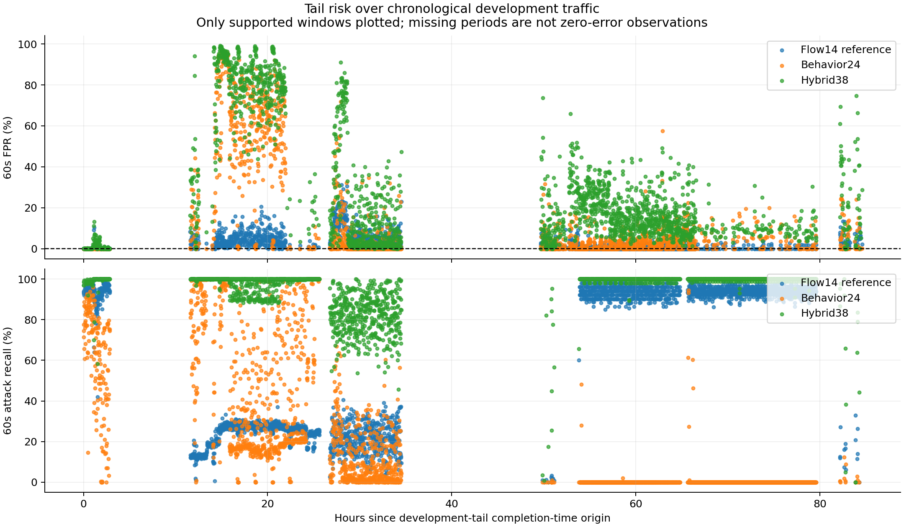
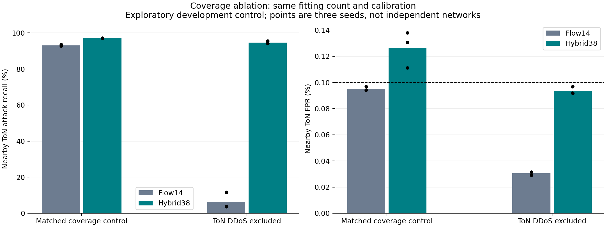

# Causal behavioral detection: results and graphs

Implemented bounded host histories and flow/behavioral/hybrid comparisons. Hybrid recall increases substantially on the full development replay, but false alarms exceed the target. Coverage and sensor-visibility controls are reported separately.

[Experiment implementations](../conducted_experiments/08_behavioral_detection.md) · [All results](README.md)

## Full behavioral detector comparison

**What the graph shows:** Six frozen pipelines score 9,160,253 development flows. The hybrid raises recall to 90.27% but also raises FPR to 8.68%; this fails the deployment operating point.

**Recorded source:** `behavioral_observation_2026-11-22/full_development_comparison.png`

## Behavioral false alarms over time

**What the graph shows:** Separates supported-minute FPR and recall across the replay. Behavioral/hybrid detectors can have extreme localized false alarms despite high pooled recall.

**Recorded source:** `behavioral_observation_2026-11-22/chronological_tail_risk.png`

## Fitting-family coverage ablation

**What the graph shows:** With ToN DDoS excluded from fitting, the hybrid retains strong nearby recall while the flow baseline drops. This local finding fails to generalize to the later stress period and is not proof of zero-day detection.

**Recorded source:** `behavioral_observation_2026-11-22/family_coverage_control.png`

## Recorded measurements

Open the compact measured outputs

- [behavioral_observation_2026-11-22/benign_group_control/stress_results.json](measurements/08_behavioral_detection/behavioral_observation_2026-11-22__benign_group_control__stress_results.json)
- [behavioral_observation_2026-11-22/family_coverage_control/nearby_results.json](measurements/08_behavioral_detection/behavioral_observation_2026-11-22__family_coverage_control__nearby_results.json)
- [behavioral_observation_2026-11-22/family_coverage_control/stress_results.json](measurements/08_behavioral_detection/behavioral_observation_2026-11-22__family_coverage_control__stress_results.json)
- [behavioral_observation_2026-11-22/isolation_forest_control/nearby_results.json](measurements/08_behavioral_detection/behavioral_observation_2026-11-22__isolation_forest_control__nearby_results.json)
- [behavioral_observation_2026-11-22/isolation_forest_control/stress_results.json](measurements/08_behavioral_detection/behavioral_observation_2026-11-22__isolation_forest_control__stress_results.json)
- [behavioral_observation_2026-11-22/nearby_results.json](measurements/08_behavioral_detection/behavioral_observation_2026-11-22__nearby_results.json)
- [behavioral_observation_2026-11-22/recent_benign_control/stress_results.json](measurements/08_behavioral_detection/behavioral_observation_2026-11-22__recent_benign_control__stress_results.json)
- [behavioral_observation_2026-11-22/results.json](measurements/08_behavioral_detection/behavioral_observation_2026-11-22__results.json)
- [behavioral_observation_2026-11-22/sensor_sensitivity_results.json](measurements/08_behavioral_detection/behavioral_observation_2026-11-22__sensor_sensitivity_results.json)
- [behavioral_observation_2026-11-22/source_transfer_control/nearby_results.json](measurements/08_behavioral_detection/behavioral_observation_2026-11-22__source_transfer_control__nearby_results.json)
- [behavioral_observation_2026-11-22/source_transfer_control/stress_results.json](measurements/08_behavioral_detection/behavioral_observation_2026-11-22__source_transfer_control__stress_results.json)

