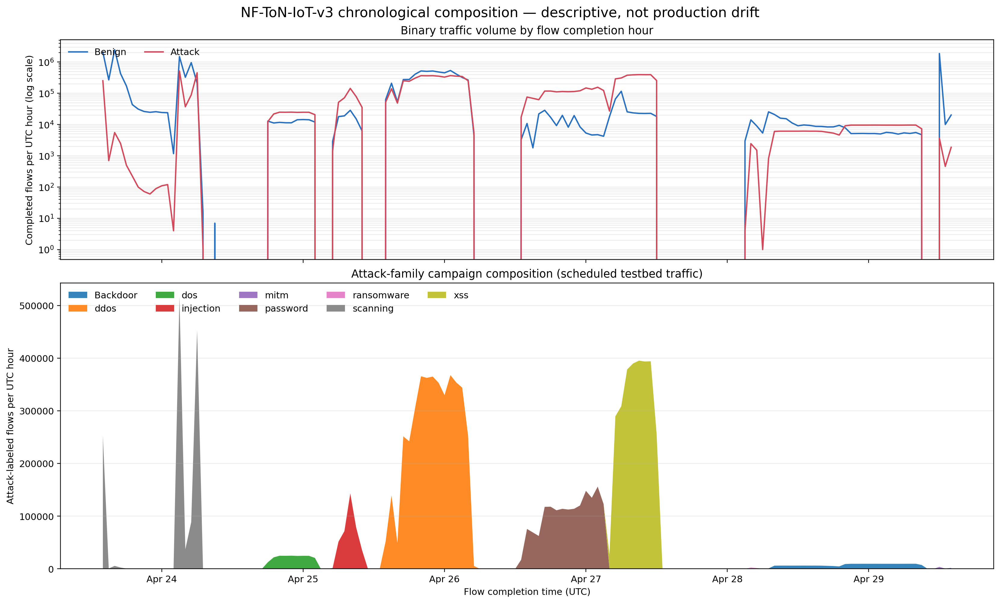
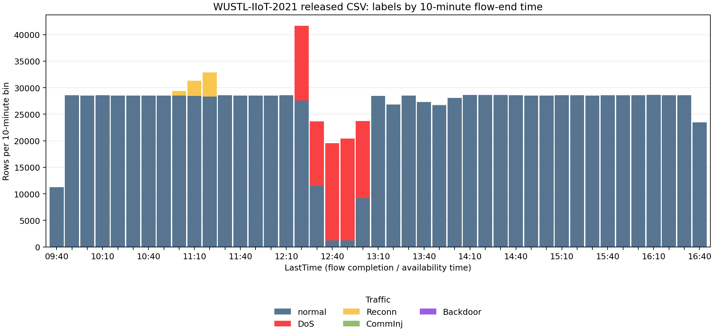
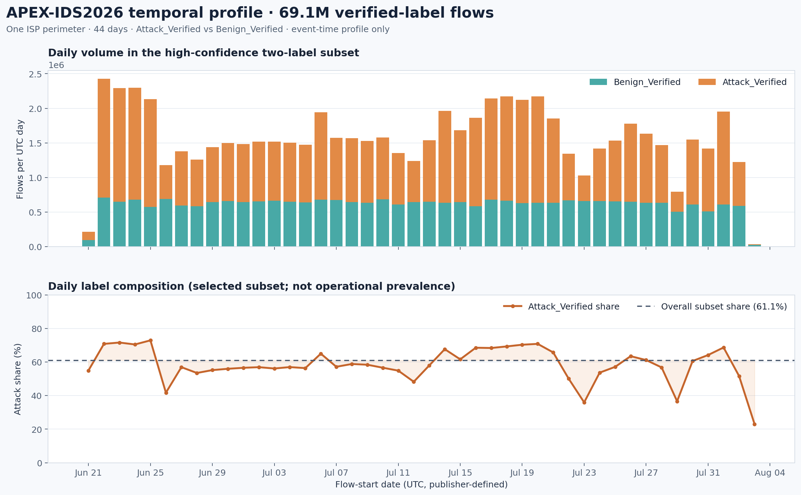
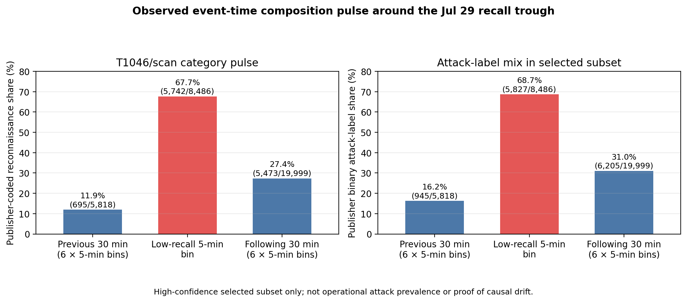
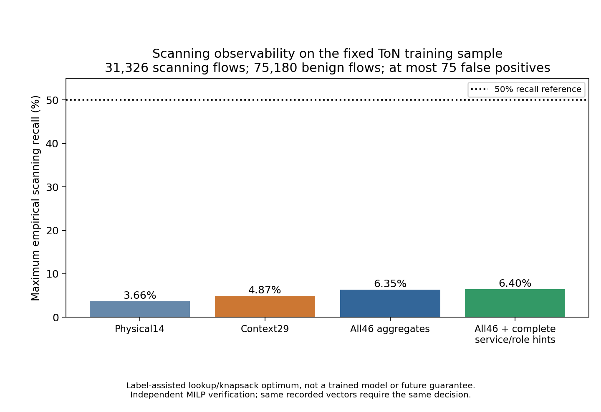
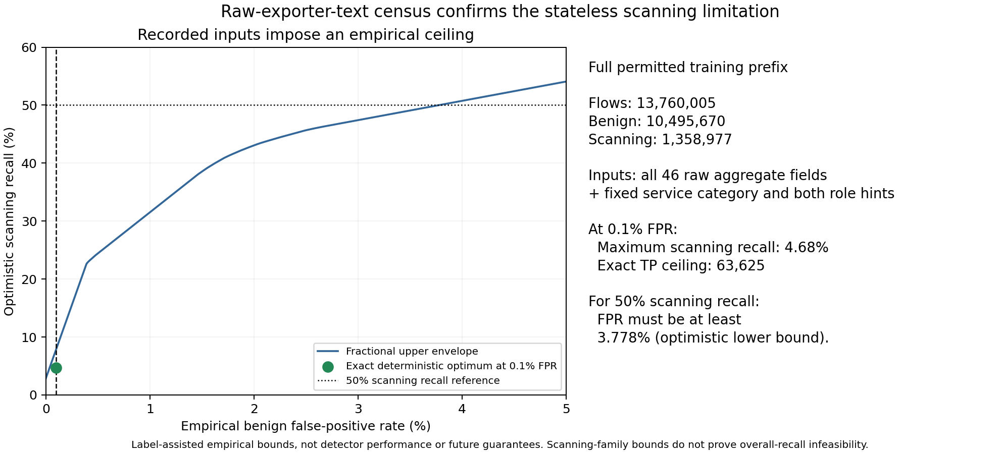

# Data integrity and observability: results and graphs

Verified timestamps, cache alignment, feature conventions and label consistency; screened temporal data sources. Empirical feature-collision bounds are scoped to the audited family and fixed records, not population guarantees.

[Experiment implementations](../conducted_experiments/09_data_integrity_and_observability.md) · [All results](README.md)

## ToN hourly campaign composition

**What we did:** Audited time ordering, class support and feature availability before treating the dataset as a chronological evaluation stream.

**What the graph establishes:** Establishes chronological attack-family and benign-support changes. This is a data-composition audit, not classifier accuracy or proof of natural production drift.

**Recorded source:** `nf_ton_iot_v3_hourly_composition.png`

## WUSTL temporal label distribution

**What we did:** Audited time ordering, class support and feature availability before treating the dataset as a chronological evaluation stream.

**What the graph establishes:** Screens whether class support and chronology permit the intended evaluation. Dataset suitability is a separate question from model quality.

**Recorded source:** `wustl_temporal_label_distribution.png`

## APEX temporal and feature availability

**What we did:** Audited time ordering, class support and feature availability before treating the dataset as a chronological evaluation stream.

**What the graph establishes:** Audits timeline/feature availability before replay. Availability artifacts must be distinguished from learned attack behavior.

**Recorded source:** `APEX_IDS2026_TEMPORAL_PROFILE.png`

## Reconnaissance pulse diagnostic

**What we did:** Ran the recorded diagnostic and inspected the relationship between traffic composition, detector errors and evaluation conditions.

**What the graph establishes:** Examines the relationship between campaign composition and errors. A concentrated pulse can distort pooled estimates; it is not a newly invented attack detector.

**Recorded source:** `APEX_IDS2026_RECONNAISSANCE_PULSE.png`

## Scanning observability on the fixed fitting sample

**What we did:** Grouped recorded feature vectors and quantified the best label-assisted empirical separation possible under the declared false-positive budget.

**What the graph establishes:** Measures label-assisted lookup optima for several recorded representations on the same fitting sample. Sample ceilings are not future guarantees; see the separate full-prefix audit.

**Recorded source:** `network_context_2026-11-21/scanning_observability_gap.png`

## Raw-text full-prefix scanning bound

**What we did:** Grouped recorded feature vectors and quantified the best label-assisted empirical separation possible under the declared false-positive budget.

**What the graph establishes:** Audits 13,760,005 permitted training records. At 0.1% empirical FPR, complete recorded static descriptors permit at most 4.68% scanning recall. This is a family-specific empirical bound, not overall-IDS impossibility.

**Recorded source:** `network_context_2026-11-21/full_training_observability_ceiling.png`

## Recorded measurements

Open the compact measured outputs

- [budget_forest_candidates/results.json](measurements/09_data_integrity_and_observability/budget_forest_candidates__results.json)
- [desktop_bundle_comparison/summary.json](measurements/09_data_integrity_and_observability/desktop_bundle_comparison__summary.json)
- [exact_topk_ablation/results.json](measurements/09_data_integrity_and_observability/exact_topk_ablation__results.json)
- [expanded_benign_calibration/results.json](measurements/09_data_integrity_and_observability/expanded_benign_calibration__results.json)
- [five_track_pilot/results.json](measurements/09_data_integrity_and_observability/five_track_pilot__results.json)
- [integrity_observability_2026-11-26/record_identity_integrity.json](measurements/09_data_integrity_and_observability/integrity_observability_2026-11-26__record_identity_integrity.json)
- [recent_target_score_diagnostic/results.json](measurements/09_data_integrity_and_observability/recent_target_score_diagnostic__results.json)
- [tolerance_threshold_audit/results.json](measurements/09_data_integrity_and_observability/tolerance_threshold_audit__results.json)

