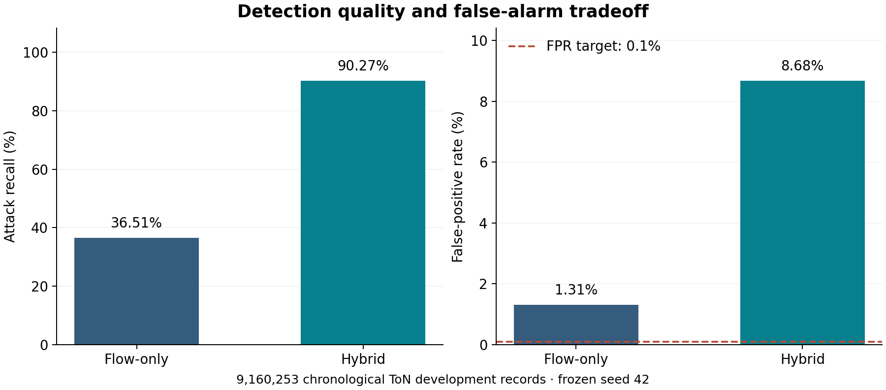
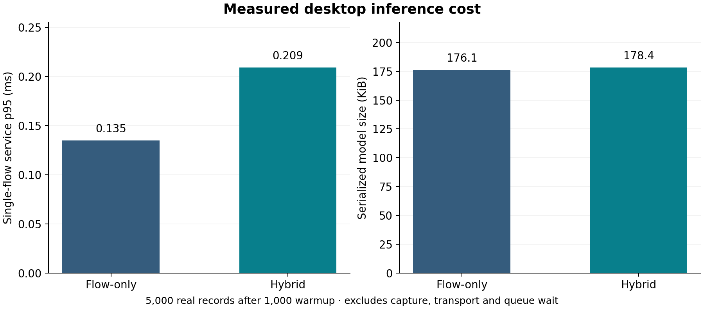

# Results and graph guide

**Start with the graphs below to review measured performance.** Measurements are from saved experiments; no illustrative accuracy curves or synthetic benchmark results are used.

## Detection and false alarms

Frozen seed 42 models, 9,160,253 chronologically replayed NF-ToN-IoT-v3 development records:

| Model | Attack recall | False-positive rate | False alarms |
|---|---:|---:|---:|
| Flow-only |36.51%|1.31%|47,177|
| Hybrid flow + behavioral history |90.27%|8.68%|313,590|

The hybrid recovers more attacks but increases false alarms. Neither satisfies the original 50%-recall / 0.1%-FPR operating point on this stream. These are development results, not independently validated production performance. [Machine-readable measurements](metrics.json) include precision, F1, family recall and worst-window FPR.

## Resource cost

An isolated desktop benchmark measures feature computation, native inference, thresholding and an in-memory consumer on 5,000 real records after 1,000 warmup records. Model files are approximately 180 KB. Timing excludes capture/export/network IO, queue waiting and startup; it is not a Raspberry Pi measurement. See [benchmark details](resource_benchmark.json).

## Evaluation discipline

- Causal histories use strictly earlier observations, not future packets or labels.
- Grouped development evaluation keeps repeated feature vectors in a single fold.
- Training, calibration, development and protected evaluation have separate roles.
- 473,085 protected UNSW records remain unscored.
- Desktop resources, flow-completion proxies and deployment assumptions are reported explicitly.
- High recall alone is not treated as success when false alarms violate the operating budget.

## Browse all conducted studies

| Study | Graphs and interpretation |
|---|---|
| Baseline reproduction | [Open results](01_baseline_reproduction.md) |
| AutoML and resource constraints | [Open results](02_automl_and_resource_constraints.md) |
| Cross-dataset transfer | [Open results](03_cross_dataset_transfer.md) |
| Chronological adaptation | [Open results](04_temporal_adaptation.md) |
| Delayed feedback and streaming safeguards | [Open results](05_delayed_feedback_and_safeguards.md) |
| Budgeted verification | [Open results](06_budgeted_verification.md) |
| Generalization and network context | [Open results](07_generalization_and_context.md) |
| Causal behavioral detection | [Open results](08_behavioral_detection.md) |
| Data integrity and observability | [Open results](09_data_integrity_and_observability.md) |

The graph pages explain what was measured, what each graph established, and the limits of the conclusion. Baseline reproduction, development results, data audits and retrospective diagnostics are identified separately.

## Machine-readable evidence

[Measurement catalog](measurement_catalog.json) links compact exports of the recorded experiment outputs. These retain scalar/per-family results while excluding large per-flow and per-window arrays. [Graph catalog](graph_catalog.json) records the original source and checksum for each figure.
